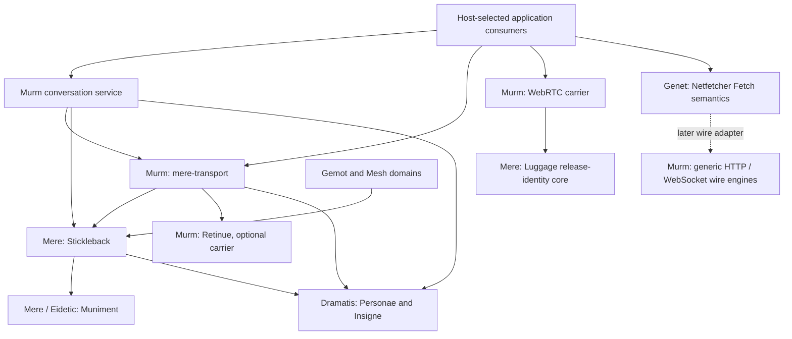

# Murm family and repository move

**Date:** 2026-10-13
**Status:** In progress (2026-10-16). The native implementation import and named
MOVE3 consumer adoption are published. MOVE4 renamed the continuing Retinue
repository to Murm with the same repository identity and refs; canonical URL
validation passed and the canonical URLs are published on main. Crate names and history remain
intact. Supplemental Isocosm source adoption is also published; its gameplay
compiler gates retain the reproduced upstream failure described below.
Registry releases and further physical/live-network qualification retain their
own gates. MOVE5's reusable wire engine and receiving Genet/Mere source
adoptions are published; Signalman's final supplier cohort is qualified.
Post-cutover R1 implements Signalman's LXMF software path and initial R2
recorded-delivery diagnostics; R3 supplies resident radio Comms and R4 adds
stock Meshtastic/MeshCore companion actors and attended desktop controls.
R5 records Windows Meshtastic/MeshCore stock-pair and native functional
acceptance, with a 500 ms MeshCore pair reconnect fixture and verified Tulle
restoration. R6 passes a bounded Djinn-backed Tucket-over-Tulle native functional
run against stock MeshCore: four tagged texts with all four protocol ACKs across
two connections, with exact history checked before fresh work after reconnect.
Both boards are restored. The fixture explicitly advertises after each Tucket
commissioning; automatic contact restoration, immediate stock MeshCore reopen,
UI cleanup and the Sennet stack leg retain their gates below.

**Canonical home:** this repository owns the migration. Mere and Genet should
cite this plan rather than keep another migration specification. The canonical
cross-repository coordinate is
`murm/design_docs/2026-10-13_murm_family_move_plan.md`.

**Related:** [documentation policy](DOC_POLICY.md),
[murmuration direction](2026-08-09_channel_murmuration.md#current-direction-coordinated-runtime-personalities),
[controller ownership](2026-09-10_murmuration_controller_plan.md),
[transport conformance](2026-10-11_transport_conformance_plan.md),
[retained-repair prototype](2026-10-11_retained_repair_simulation_profile.md).
Adjacent owners: `mere/design_docs/mere_docs/implementation_strategy/2026-07-12_murm_peer_runtime_and_moot_domain_plan.md`
and Genet's current `components/netfetcher/src/lib.rs` / `src/transport.rs`.

## 1. Decision and scope

Murm becomes the family for communication implementations, peer carriers,
network protocols, device participation and control, shared radio runtime, and
their diagnostics. Retinue remains the Reticulum implementation inside that
family. The existing Retinue repository is the foundation; keep its identity,
history, releases, issues and radio tree instead of creating a blank replacement.

The existing `murm` package remains the conversation service. No crate rename,
universal transport trait, or mandatory umbrella facade is required by the
family promotion. Streams, constrained packets, foreign signed feeds and board
control retain their actual identities, delivery and privacy contracts.

Selected placement for the first move:

| Implementation | Current home | Destination / decision |
| --- | --- | --- |
| `retinue`, `outrider`, `sennet`, `tucket` | Retinue `crates/` | Keep names and paths in the foundational repository |
| `tulle`, `selvage`, `seneschal`, `postilion` | Retinue `crates/` | Keep radio, configuration and host contracts together |
| `radio-face`, `radio-hand`, `radio-mirror`, `retinue-sim` | Retinue `crates/` | Keep their present feature/target boundaries |
| `tinyssb-core` | Retinue `crates/` | Keep as a foreign tinySSB feed verifier; family membership is not full SSB chat support |
| `retained-repair` | Retinue excluded workspace | Keep its independently pinned prototype workspace and qualification status |
| Linkboy, Signalman, Signalman desktop, board firmware | Retinue `apps/` and `firmware/` | Keep application identities, independent desktop workspace, images and board-state formats |
| `murm` (lib `murm`) | Mere `crates/murm/murm` | Import to a separate native workspace in this repository |
| `mere-transport` (lib `transport`) | Mere `crates/murm/transport` | Import with scoped identity, shared endpoint and optional Reticulum boundaries intact |
| `mere-webrtc-carrier` (lib `webrtc_carrier`) | Mere `crates/murm/webrtc-carrier` | Import; preserve default core, browser/native features and external Luggage core dependency |
| `stickleback` | Mere `crates/stickleback` | **Keep in Mere for the first move**, as a neutral shared replication supplier |
| `netfetcher` | Genet `components/netfetcher` | **Keep Fetch and browser WebSocket policy in Genet**; qualify reusable wire implementations for Murm later |
| `mere-fetch`, `page-load` | Mere `crates/system/` | Keep host/session orchestration and portable page-load vocabulary with existing owners |

Identity and credential authority remain in Dramatis/Personae. Djinn owns the
resident host and its persisted pairing/operating choices. Gemot owns governed
membership, capabilities and Standing. Distillery owns compute offers and
leases; ESP owns inference/embedding execution. Applications own document,
conversation and activity decisions. A Murm implementation consumes those
owners' inputs and supplies observations; repository placement grants no
additional authority.

## 2. Build and dependency map

Keep two separate stack-wide decisions: the working toolchain and the minimum
supported Rust version (MSRV). Pin the working toolchain to current stable Rust
1.99.0 for this rollout. The selected common owned-package MSRV is **1.97.1**;
it remains below the working toolchain and advances independently when
language use, dependencies or an explicit support decision require it. The
owner rejected both preserving Rust 1.88 by assumption and making Rust 1.99 the
minimum by assumption. The canonical policy is in
`mere/design_docs/2026-08-12_family_composition_thesis_brief.md`, section
"Shared Rust toolchain and minimum version (2026-10-13)".

The locked Mere graph declares Rust 1.91 for Iroh and 1.96 for the refreshed
p2panda supplier. Its highest declared floor is 1.97.1, from WESL/WGSL; Knot
declares 1.97. Fetched owner manifests across eleven active repositories and
2,491 cached registry manifests from 71 tracked lockfiles contain no declared
minimum above 1.97.1. Higher working-toolchain pins, including 1.98.1, are
separate settings and do not by themselves establish a higher MSRV.

This selects a rollout floor, not a tested compatibility receipt. Inspect
undeclared requirements and qualify supported feature/target configurations on
1.97.1 in MOVE1. The registry inventory has 277 uncached package versions and
does not exhaustively resolve independent Git suppliers outside Mere. Any
actual requirement above 1.97.1 must be resolved or brought back into the shared
MSRV decision before claiming stack-wide support. Inventory evidence is saved
in `Code/targets/murm-shared-msrv-selection-20261013.json`.

The qualified layout keeps the radio/firmware workspace at the root, native
peer carriers in `native/`, and the reusable HTTP/WebSocket engine in `wire/`.
Each has an independent dependency cone. Signalman's desktop host remains a
separate app workspace. All roots follow the working toolchain 1.99.0 and the
separately qualified common MSRV 1.97.1.

Current implementation layout:

```text
Murm repository, continuing Retinue history
  Cargo.toml                  radio workspace
  crates/                     existing radio/protocol/control package paths
  apps/                       existing host apps and separate desktop workspace
  firmware/                   existing targets and packaging
  native/
    Cargo.toml                independent native workspace
    crates/murm/              package murm; library murm
    crates/transport/         package mere-transport; library transport
    crates/webrtc-carrier/    package mere-webrtc-carrier; library webrtc_carrier
  wire/
    Cargo.toml                independent wire workspace, no Genet back-edge
    crates/wire/              package murm-wire; protocol HTTP/WebSocket engines
  design_docs/                canonical migration plan and existing evidence
```

The radio root excludes native, wire and the independent desktop workspace.
Their defaults cannot activate native networking in an embedded build. Owned packages
converge on the selected shared MSRV of 1.97.1; a newer working toolchain
does not change that value automatically.
The WebRTC core still gets its default Wasm check; the native workspace name
does not turn its portable core into a native-only API. Retinue's release
profile is flash-size-oriented; select native profiles explicitly instead of
accidentally inheriting them through repository placement.

Arrows below mean package consumption, not authority transfer. This is a
selected-boundary map, not the entire transitive graph:



The direct dependency inventory is saved as
`Code/targets/murm-family-move-map-20261013.json`, derived from locked Cargo
metadata. It records seven relevant packages and 33 consumer edges, including
dependency kind, optional features and target conditions. It also exposes the
non-obvious address-book edge: `mere-transport` already consumes Stickleback.

### Stickleback stays a shared supplier

Stickleback's normal dependencies include Muniment, Personae/Insigne,
`mere-proofs` and p2panda. It does not depend on the Murm transport or on Gemot.
Keeping it in Mere permits Murm's transport and conversation packages to
consume it while Gemot, Mesh and the host applications remain independent
domain consumers. A repository relationship in both directions is acceptable
only while the actual package graph stays acyclic and sources stay immutable.
Do not make the new native workspace depend on Mere's aggregate application or
ports to reach these leaf suppliers.

Moving Stickleback into Gemot is rejected for this first move: generic
replication would become owned by one governed-space consumer. Extracting it
with its shared suppliers later remains possible if release coordination
proves awkward. That is a separate change with all consumers represented,
rather than a prerequisite for the carrier/radio family promotion.

### Netfetcher: take the wire, keep the web contract

The historical standalone Netfetcher repository is archived. The active source
is Genet `components/netfetcher` at `7a8c5b8cb49`, package version 0.1.1. Its
September 2 authority split is explicit: web-observable Fetch behavior stays
above `netfetcher::Transport`; the host supplies the wire through
`FetchContext.transport`. Feature-disabled builds retain semantics without the
HTTP wire implementation, although they still have runtime/helper dependencies.

Genet retains CORS, redirects, cookies, response tainting, cache semantics,
referrers, mixed-content handling, CSP, integrity and content decoding.
Murm may provide pooling, TLS connections, HTTP/1-2-3 exchange, proxies,
timeouts, connection diagnostics and raw WebSocket carriage. Host policy still
selects trust, credentials, partitions and limits.

The existing seam uses `netfetcher::Method` and its body stream, and WebSocket
`connect` mixes HSTS/CSP/cookie policy with the tungstenite connection call.
Moving those files wholesale would move policy too. Select a generic wire
engine boundary before extraction. The dependency-safe composition is a Murm
wire engine using protocol-level values (for example `http` types) with no
dependency on Netfetcher, plus an adapter in Genet implementing Netfetcher's
existing seam. Genet can then depend on the Murm engine; the engine must not
depend back on Netfetcher. Preserve public Netfetcher entry points through that
adapter, without leaving two shipping wire engines as competing authorities.

HTTP/3 and Iroh both using QUIC does not make their protocols or endpoints
interchangeable. Keep their wire protocols and trust inputs explicit. Browser
WebSocket policy checks occur before opening the raw connector, and response
cookie processing remains with the policy owner after connection.

## 3. History, package identity and durable data

Use the existing Retinue repository as the continuing repository. Preserve
Retinue commits, tags, published release references and existing merged radio
histories. Import selected Mere trees through a history-preserving merge that
retains the unfiltered source commit as a parent/ancestor, with only selected
trees present at the destination tip. Source commits must remain reachable in
a fresh clone. A rewritten subtree split alone does not satisfy preservation
of original commit IDs.

The execution recipe must be rehearsed in a disposable repository before it
touches the destination branch. Attach the source ancestry, stage the selected
trees under the native paths, and inspect the resulting merge before committing.
Do not merge the whole current Mere tree into the destination working tree.
Git's [merge documentation](https://git-scm.com/docs/git-merge) and
GitHub's [subtree merge recipe](https://docs.github.com/en/get-started/using-git/about-git-subtree-merges)
describe the ancestry/tree distinction. Acceptance includes `merge-base
--is-ancestor` for representative original commits, original object availability
in a fresh clone, blob equality before manifest edits, original author/message
preservation, and an attribution check across the path move. Do not assume
`log --follow` or blame navigation survives automatically.

Retaining unfiltered Mere ancestry also retains its other historical objects.
Current packed-object context is approximately 216 MiB for Mere and 25 MiB for
Retinue; that is not a measured incremental import or future clone size.
Measure the rehearsal. A later original-ID-preserving Genet wire extraction
would also need to account for Genet's full ancestry rather than conceal it
behind rewritten split commits.

Preserve package names, library aliases, feature names, wire identifiers and
ownership boundaries. Materialize inherited edition, version and license fields
in the receiving workspace without silently applying one family-wide license.
Keep per-crate LICENSE, NOTICE, provenance ledgers and vendored terms with their
sources. Repository metadata may change for new releases; published versions
and their old metadata remain historical records. Do not attempt to republish
an existing version under a new home.

This move does not alter board owner records, A/B journals, configuration
magics, replay counters, conversation IDs, signed post identities, key scopes,
ALPNs, native-drop codecs or installed firmware. No board is flashed as a side
effect of repository restructuring.

## 4. Move phases and done conditions

### MOVE0: freeze sources and establish import boundaries

Record the Retinue foundation, the reviewed Mere import ref, package contents,
Cargo graph, consumer pins, licenses, workflows, release/feed paths and
historical test scope. Retinue baseline is `973e317a0`; Mere's current refresh
candidate is `31e6dbf18`, with published p2panda supplier tag
`mere-p2panda-net-0.7.5-upstream-20261013`. Mere main also has a later doc-only
commit at the time of planning. Choose the actual immutable import ref after
reconciling the refresh with current main; this document does not declare that
local candidate integrated or deployed.

Registry lookups confirm the selected versions of Stickleback (0.1.1),
Muniment (0.1.2) and `mere-proofs` (0.1.0) exist; existence alone does not prove
supplier identity or API equivalence. Inspect their exact source/package
contents. WebRTC's Luggage dependency is currently a path-only supplier in Mere
with native defaults explicitly disabled. Confirm an exact external release or
immutable Git leaf dependency before import. Keep the updater application and
update policy outside Murm.

**Done when:** every imported file and needed external leaf supplier has a
source/identity entry; all normal/dev/target consumers and fork patches have
been inventoried; the original-ID import rehearsal passes; source authority
and toolchain boundaries are resolved. Planning evidence does not close the
actual import gate.

### MOVE1: unify Rust and establish the receiving build roots

Inventory toolchain pins, owned `rust-version` fields, CI compiler jobs and
independent workspace/probe/firmware roots across the active stack. Pin the
working toolchain to the coordinated current stable release (1.99.0 for this
pass). Independently qualify the selected common MSRV, 1.97.1, against source
requirements and supported dependency/feature/target graphs, then align owned
minimums to `rust-version = "1.97.1"`.
Use a current-toolchain CI lane for development checks and a separate selected
MSRV lane for supported builds/tests. Upgrade the working pin without raising
the MSRV automatically. An actually required target compiler fork/nightly must
be recorded as a target realization, with its capabilities checked against the
support policy; it does not create an assumed older radio MSRV policy.

Use Cargo's supported `build.build-dir` for intermediate artifacts and retain
`build.target-dir` for delivered outputs. Inventory environment overrides,
cache keys, release scripts and executable-path discovery; tests must obtain
executable locations from Cargo output rather than assume an intermediate
`target/debug/deps` layout. Keep worktree/platform/configuration isolation.

Qualify the proposed native workspace and root exclusion, or select one
workspace if its graph remains bounded. Record profiles; carry the immutable
shared p2panda patch set in each consuming build root because dependency
workspaces' patches do not propagate to consumers. Preserve radio dependency
defaults, desktop isolation and firmware target ownership.

**Done when:** active owned toolchain pins follow the qualified working
release, owned minimums follow the separately selected and tested common MSRV,
and CI checks both; each target's actual compiler is recorded; build-dir
and delivered-artifact paths work in native/browser/embedded and packaging
recipes; receiving workspace graphs resolve only intended suppliers. No
placeholder crate or application dependency stands in for a real leaf
supplier. Check package graphs in every independent build root. Old compiler
receipts do not establish qualification of the new baseline.

### MOVE2: import and qualify the three Mere implementations

Import `murm`, `mere-transport` and `mere-webrtc-carrier` with source ancestry
and selected content. Use external Stickleback, Muniment, proofs, Personae,
Notochord and Luggage core at qualified exact sources. Keep published aliases
and API/wire identities. The existing radio crate may be a local optional
Reticulum dependency inside this repository, but its newer code requires its
own adapter qualification; do not call the current old Mere pin refreshed by
changing a path.

**Done when:** package-content/attribution checks pass; the scoped carrier-key
regression, conversation causality/retention, durable reopen, protected drops
and session admission pass from the receiving workspace. Real QUIC/gossip/
LogSync and optional Reticulum checks have source-bound receipts. WebRTC core,
native and browser feature checks retain their exact scopes. Repeat physical
radio or browser acceptance only with the validation lane and fixture handed
over. Sandbox-denied network execution is an open receipt, never a pass.

### MOVE3: publish suppliers and cut consumers over

Publish immutable sources and new versions where needed, then coordinate
consumer pins. Primary consumers include Mere Comms/Moot, Djinn, Distillery,
Gemot/Commons test seams, native fetch blob paths and Graphshell; also inspect
Turnstone, Woodshed, Knot and Retinue's independent desktop consumer. Update
standalone probe/harness manifests and test/dev edges. Keep one p2panda source
graph and Personae type identity across the composition.

**Done when:** named production consumers resolve the new source under locked
builds, including target-specific/default-off lanes; native and portable
dependency cones remain within their contracts; no sibling checkout override
is required. Source and destination must not both receive independent fixes to
the same implementation during the transition. Remove the old Mere source
trees only after consumer qualification and source attribution are complete.

### MOVE4: canonical repository/name cutover

Rename the existing Retinue repository to Murm, retain its repository identity
and refs, and update remotes, new-release metadata, CI references, packaging,
firmware catalog/feed locators and family documentation together. Keep crate
names and existing paths. Do not recreate a repository at the old name.

GitHub documents redirects for ordinary repository access but exceptions for
Pages project URLs and hosted action calls. Inventory those and verify actual
consumers; redirects are not a complete release/feed qualification. See
[GitHub's rename guidance](https://docs.github.com/en/repositories/creating-and-managing-repositories/renaming-a-repository).

**Done when:** original refs and release artifacts resolve; old links retained
as historical evidence still work where promised; current consumers use the
canonical home; CI, installer/catalog lookups and documentation navigation
pass. Repo rename and package publication each have their own receipt.

### MOVE5: qualify Netfetcher's reusable wire engines

This follows the first family cutover rather than blocking it. Rehearse an
original-history-preserving extraction from the active Genet source. Define
the generic HTTP engine and Genet adapter first, then a raw WebSocket connector
whose policy wrapper remains in Genet. Keep Netfetcher's crate identity,
default feature behavior and public connection/fetch entry points.

**Done when:** literal one-hop tests prove no redirect, cookie, header or body
policy is silently added by the wire engine; existing Fetch and WebSocket
policy refusals still occur before connection; raw status/headers/body and
failure mappings remain consistent. Native HTTP/1-2-3 and WebSocket transport
receipts, Genet harness/Fetch conformance gates, host partition/trust checks and
feature-disabled dependency checks are separate. Prove no Genet/Netfetcher
dependency back-edge in the generic Murm engine. Publish and adopt only after
Genet's `genet-wpt` host and Mere's `mere-fetch` host demonstrate the same
boundary. The current default transport uses a process-wide pool; preserving
it does not establish per-session trust or pool isolation. A host-selected
partitioned transport needs explicit configuration and its own receipt.

## 5. Findings and progress

### 2026-10-13 planning pass

- The foundational Retinue tree already contains the requested protocol,
  radio, UI and management leaves. Its root manifest and CI currently declare
  a Rust 1.88 lane, while the owner now requires a shared current working
  toolchain and the separately selected shared MSRV of 1.97.1 across the stack.
  The old values are migration inputs, not an owner commitment to preserve them. Genet-backed desktop and retained-repair
  prototype workspaces remain excluded for dependency/target reasons.
- Locked Mere metadata identifies seven relevant supplier packages and 33
  consumer edges. Stickleback has no normal transport/Gemot dependency;
  `mere-transport` consumes Stickleback for its address book. WebRTC consumes
  Luggage's release-identity core. These edges determine the first move.
- Netfetcher's archived standalone clone is not the import source. The current
  Genet tree explicitly owns web-observable semantics above the one-hop seam;
  WebSocket policy and connection calls still share one module and need a real
  extraction boundary.
- Source checks select **Stickleback in Mere** and **Netfetcher semantics in
  Genet**. Generic HTTP/WebSocket wire code is a later Murm lane. These choices
  keep Gemot governance, host persistence, identity and update policy explicit.
- The earlier Murm refresh receipt records 289 passing owner/admission tests,
  with twelve network cases excluded by OS-monitor sandbox restrictions. It is
  source qualification evidence, not acceptance of an imported crate or new
  physical/browser behavior.
- This pass created the map and plan only. MOVE1-MOVE5 are unexecuted. Registry,
  history and direct-dependency inspection do not replace the receiving build,
  publication, consumer or physical receipts.

### 2026-10-13 compiler-policy correction

The owner clarified that Rust 1.88 was not a requested compatibility promise.
He wants the newest working Rust, including build-directory support, and a
unified minimum across the stack. The initial Rust 1.88 preservation inference
is withdrawn. The subsequent interpretation that the newest toolchain must
also be the MSRV is withdrawn too. Rust 1.99.0 is the selected working release;
build-dir support stabilized in Cargo 1.91. At this correction stage, the shared MSRV was a separate,
unselected decision; the subsequent selection is recorded below. Locked
dependency declarations made 1.96 a Murm candidate and identified wider-stack requirements at 1.97/1.97.1 for qualification or
supplier adjustment. No MSRV compiler runs were performed in this correction.
Repository manifests and CI still require the MOVE1 rollout; this document
does not claim that the stack has already been upgraded.

### 2026-10-13 shared MSRV selection

The owner accepted 1.97.1 if no requirement pins a higher minimum. Fetched
owner-manifest and locked-dependency declaration inventories found no higher
floor in their inspected scope. Select Rust 1.97.1 as the shared owned-package
MSRV and retain Rust 1.99.0 as the working toolchain. MOVE1 must qualify the
actual supported configurations on both compilers before claiming the rollout
complete; declarations, uncached suppliers and existing development pins do
not substitute for those compiler runs. The stack-wide manifest/CI rollout
remains unexecuted.

### 2026-10-13 defaults rollout and import execution

The owner authorized applying the selected defaults/MSRV and beginning the
implementation moves. Isolated current-source checkouts cover all 21 active
Rust repositories in the organization, including Dramatis and the repositories
absent from the earlier local-only inventory. Owned active package manifests
now declare Rust 1.97.1, stable working pins use 1.99.0, and intermediate build
artifacts use `{workspace-root}/target/build`. Existing compiler jobs are
aligned by role; separate declaration-policy lanes run on both versions.
Vendor/patch supplier manifests and frozen receipt manifests are preserved.

All 42 root metadata checks pass on their named compilers. These validate
package declarations and workspace loading, not every platform's compiled
support. The shared CI repository's wgpu MSRV default also moves to 1.97.1.
Native/radio compiler runs and source imports are in progress. The import
inventory adds Castellan's MPL allocator-tracker test helper, currently included
by relative path from the transport seed-residue binary; it must become a
package-local test fixture with source attribution, not a lost test.

### 2026-10-13 history-preserving native import

The receiving repository now retains Mere source commit `fabfd10ef7f8` as an
ancestor through import merge `46d368c6d`. The disposable rehearsal verified
72 original crate blobs unchanged at import, source ancestry and original
commit availability in a fresh clone. Cross-path blame attributes the imported
source to its original Mere commits and authors. `native/source-import.json`
records the immutable source, tree map, local test helper and formatting policy.

The independent native workspace supplies the three original package names and
versions, materializes their Mere MPL licenses, and pins Stickleback, Muniment,
proofs and Luggage core to immutable Mere sources. Personae/Insigne/Notochord
share the existing immutable Dramatis source; the p2panda patch set is identical
to the reviewed refresh. Metadata shows one source per shared supplier. The
optional Reticulum carrier uses this repository's current Retinue crate and
compiles in the all-features native check. Luggage native updater code is not
enabled by the WebRTC core.

On Rust 1.99.0, 66 conversation, four in-process admission and 44 WebRTC core
tests pass. All native features/test binaries and the browser adapter/test
binaries compile. Radio library tests pass 913 cases on each selected compiler.
The same imported-native compiler lanes on 1.97.1 are in progress. Local runs
exclude the three live gossip/LogSync and two authenticated p2panda cases because
this sandbox denies Iroh's OS network monitor; the receiving hosted CI lane
runs them without those exclusions. No physical radio or headed browser run is
claimed. Consumer source cutover follows the receiving compiler checks.

### 2026-10-13 receiving compiler qualification

Both Rust 1.97.1 and 1.99.0 pass the imported workspace's 66 conversation,
four in-process session-admission and 44 WebRTC core tests (114 per compiler).
Both also compile all native features/test binaries and the browser adapter's
Wasm test targets. Native formatting retains Mere's canonical policy and
passes. The T114 firmware checks on 1.97.1; the 1.99.0 check is in progress.
The eight radio library suites pass 913 tests per compiler. This qualifies the
receiving software scopes; five imported live-network cases and physical/
headed acceptance retain their separate receipts. No installed board data is
changed.

The imported Git supplier will be published before the primary Mere consumer
cutover. Preserve frozen historical receipt manifests at their recorded source
commits; they are not active path overrides to rewrite into the new topology.

The T114 cross-target checks now pass on both 1.97.1 and 1.99.0. Native rustdoc
passes with warnings denied after correcting stale/private API references;
these are documentation-only repairs. The disposable rehearsal repositories
and completed MSRV/radio/embedded build caches were removed after their logs
and receipts were saved, to release disk space. Original history remains in
the actual receiving repository. The imported source is ready for immutable
Git publication and the first Mere consumer cutover; crate-registry publication
and repository rename remain later phases.

### 2026-10-13 immutable supplier publication and primary cutover

Receiving commit `b49df894635b` is published on the continuing Retinue main,
with source ancestry and the native workspace. Mere's working cutover now
names that exact Git source for all three implementations and removes their
old source trees. The root's Retinue/Outrider/Postilion/radio-hand pins move to
the same family source, and Mere's source patches preserve one local shared
leaf identity for imported suppliers. Commons test edges and the active Burn
Remote fixture are rewired; the fixture carries its own p2panda/shared-leaf
patches. The Mesh inventory harness resolves and hashes the transport supplier
through Cargo metadata, rather than assume its former sibling path.

The primary cutover is under compiler/metadata qualification and is not yet
published. Frozen receipt manifests retain their recorded historical sources.
Other applications' old immutable Mere pins remain valid snapshots; adopting
this newer Mere source is a separate coordinated consumer update, not a
rewrite of already published history. Repository rename and Netfetcher wire
extraction remain later phases.

### 2026-10-13 primary consumer qualification

The Mere cutover now passes locked workspace resolution, the port/Graphshell
browser dependency boundary gate, Gemot's 95 non-network tests, Stickleback's
99 tests and all 25 Comms tests with the actual Murm adapter enabled. Signalman
and Commons all-target compiler checks pass against the new family source.
The active Burn Remote fixture's locked metadata resolves one selected
transport/shared-leaf/Personae/p2panda source each. Its GPU/remote receipt was
not rerun. The old Retinue 0.2 package remains a pre-existing, separate-version
consumer in the wider Mere graph; it is not a second Retinue 0.3 source.

The published supplier, fetched by Cargo from GitHub, retains the original
Mere source commit as an ancestor. Receiving packed objects measure 228.05 MiB;
this records the actual receiving repository, not an incremental network-size
claim. Current primary checkouts were fast-forwarded only while clean. The
remaining owner checkouts and already published older immutable consumer pins
were preserved. The exact compiler/supplier/log scope is saved locally in
`Code/targets/murm-first-move-20261013.json`.

### 2026-10-13 first move published

Mere's primary cutover is published at `4749f98a0`; active source-reference
repairs follow at `0b9b7a9b2`. The three former source trees are gone from
current Mere and are supplied only by the immutable receiving Git source.
The defaults changes are published across all 21 active Rust repositories plus
the shared CI repository. Clean primary checkouts are synchronized; unrelated
worktrees, frozen receipts and older published source pins remain preserved.

This closes the first implementation move and the primary Mere consumer
cutover. Full application adoption, crate-registry releases, the canonical
Retinue-to-Murm repository rename, and Netfetcher wire extraction remain open
phases. The hosted native runtime workflow is dispatched but was still queued
at the final check; local twelve live-network exclusions and physical/headed
acceptance are not closed by software compilation or metadata policy checks.

### 2026-10-13 — remaining app adoption underway

MOVE3 now covers the active independent roots in Knot (including optional
NomadNet), Woodshed/Hocket/Redshank, Turnstone, Cleromancy, Isocosm and its
products, the public site graph, and Signalman desktop. The active Mere
`murm-direct-phy` probe still named removed source directories and now takes
the immutable imported crates. Historical receipt manifests remain frozen.
Outer roots restate the owner patches so imported carriers, Personae,
Muniment and p2panda do not split their types. Resolution, compilation and
software tests are recorded separately; physical and headed claims retain
their original source-bound receipts.

The hosted native workflow is queued because the repository Actions API
reports `enabled: false`; permission to enable it was requested. MOVE4 remains
gated on checks. Live repository inventory finds no Pages site and no
published releases. Existing crate names and directory paths remain intact.

### 2026-10-13 — local validation gate selected

The owner chose to keep Actions disabled and use available local checks for
the repository cutover. The Actions permissions endpoint remains disabled;
the hosted workflow has no jobs and GitHub refuses cancellation of its
dormant run. No CI success is claimed. Live UDP/gossip/session tests that the
sandbox cannot execute remain an explicit qualification gap rather than a
repository-rename gate under this direction.

Outer-root optional-feature metadata resolves one imported carrier, Personae,
Muniment and p2panda family wherever those packages are selected. App
compilation exposed Cambium pointer cancellation in Signalman, Knot and
Woodshed, and the standalone V7 probe needed Dramatis
`identity::delegation::Issue` in scope. Cancellation releases interaction
state without committing an abandoned placement or firing a game action.
Software checks and focused cancellation tests continue before MOVE4.

### 2026-10-13 — named application software gates pass

The named MOVE3 consumers pass local Rust 1.99.0 compilation: Signalman
desktop, Knot (including its optional Retinue/NomadNet targets), Woodshed,
Hocket, Redshank, Turnstone, Cleromancy, the public site graph, and Mere
Djinn/Moot/Distillery/Graphshell plus native fetch with `iroh-blobs`. The active
V7 probe compiles from immutable suppliers without sibling overrides. The
public site passes 83 cases, Signalman/comms 34, the desktop network face seven
including cancellation, and Knot
`stale_hidden_invalid_or_click_only_gestures_cannot_author_placements` passes
with cancelled-preview and late-release assertions. These are software
receipts; physical and headed acceptance is unchanged.

An additional Isocosm audit resolves the imported supplier under all features,
but current gameplay compiler gates fail with ten errors. A clean archive of
`2260b026bf1bbac9039ff8ddb0d001cc2b520ab5` reproduces the exact same errors,
and `shared/isocosm/src` has no diff. The active wing plan still defers those
gates under ruling826. Its pin changes remain an uncommitted review candidate
in `isocosm-murm-rust-defaults`, with a baseline-comparison receipt and patch
under `Code/targets/`; scope clarification was requested before treating the
gameplay work as a MOVE4 gate. No gameplay repair or success is claimed.

Native MSRV qualification is being refreshed in a separate local gate receipt;
Actions remains disabled by owner direction.

### 2026-10-13 — canonical repository cutover verified

MOVE3 is complete for the named production consumers. MOVE4 renamed the
existing GitHub repository to `merely-made/murm`, retaining repository ID
`1291698578` / `R_kgDOTP3Bkg`, `main`, and byte-identical advertised refs at
the rename. There were no published releases and no Pages site. The old
repository URL resolves to the same ID and the complete Mere source ancestry
still reaches `fabfd10ef7f8a34058907f9a9c2b1e1a311be82f`. No repository was
created at the old name. Crate names, versions, directories, package IDs and
firmware payloads are unchanged. Actions remained disabled throughout.

Current supplier/remotes/repository metadata, firmware/catalog locators, org
profile and active family references now use Murm. Old-source Cargo patch
keys remain where immutable published suppliers still name Retinue; their
targets are canonical Murm or the receiving workspace. This closes Mere
onto one Retinue 0.3 source, including its older Knot/NomadNet consumer.
Twenty-three independent all-feature graphs and the Mere root plus Burn
Remote fixture resolve the canonical supplier without sibling source
overrides or duplicated transport/Personae/Muniment/p2panda families.

Fourteen named local compilation/test scopes passed again after the URL
change. Site 83, Signalman 34 and desktop-network seven tests pass; Knot
cancellation passed one focused test before the URL-only change. Native
receiving gates passed on both Rust 1.97.1 and 1.99.0: 66 conversation tests,
four admission tests, 44 portable WebRTC tests, native all-target/all-feature
compilation and browser WebRTC target compilation. Three live gossip and two
live admission cases were filtered because local network execution is
unavailable; no fresh network, physical-radio or headed acceptance is claimed.

The public site's immutable version 3 firmware feed remains SHA256
`01076ad8a6f705c296ef7bee746d40899a8e3085c399511f62e549ea265492f5`.
Its public navigation is canonicalized after custody verification. Generated
route/face trace bytes and their original provenance also remain intact;
public links use Murm. Stable graph ID `retinue` and package/schema IDs keep
existing references valid while the displayed repository name is Murm.

The additional Isocosm pin/adapter audit remains an uncommitted candidate,
not a green gameplay build: the candidate and untouched baseline at
`2260b026bf1bbac9039ff8ddb0d001cc2b520ab5` reproduce the same ten simulator
errors. Isocosm upstream advanced to `55f48769d7ccac51bf70160f785da616e5259690`
during final reconciliation; that gameplay revision was not compiled here,
and the candidate needs reconciliation before publication. It remains separate
from the named MOVE3 cutover. MOVE5 Netfetcher wire extraction, crate-registry publication and
further network/physical/headed qualification remain open in this plan.

### 2026-10-13 — supplemental Isocosm adoption published

The owner authorized migration after the known simulator baseline report.
The candidate was preserved in a recovery branch and named stash, reconciled
without conflict onto Isocosm `55f48769d7ccac51bf70160f785da616e5259690`, and
published as `983c0e7b` on `merely-made/isocosm` main. This supersedes the
uncommitted-candidate status above. VTT communications now selects canonical
Murm `b49df894635bac95823284efee6c445885eaf62a`; the VTT, Eponym, Mesocosm,
shared host, parry-ground probe and shared Isocosm/Isomere/Isometer roots use
coherent Mere `0b9b7a9b`, Genet `7a8c5b8c` and Dramatis `0234e7ee` where
those suppliers are reached. Package names, versions and source history stay
intact. Eponym handles Cambium pointer cancellation by stopping charging.

All eight roots pass locked, offline, all-feature dependency resolution.
Selected graphs contain no old Retinue supplier URL, duplicate transport or
identity family, sibling Git source override, or dependency declaration above
MSRV 1.97.1. Sixty-three newly added unused patch rows were removed, with the
selected package IDs unchanged; existing upstream patch policy is retained.

Fresh VTT and shared-host all-target/all-feature compiler checks, and Eponym
and Mesocosm all-target checks, each stop on the same ten simulator errors.
An untouched Git archive of current upstream `55f48769` reproduces the exact
same ten coded diagnostics. `shared/isocosm/src` and the gameplay/runtime
sources were not repaired by this dependency move. These are open compiler
gates, not successful application builds; gameplay acceptance remains in the
wing after-pass. No gameplay tests, tuning or headed/GPU checks ran.

The source-adoption receipt is
`Code/targets/murm-isocosm-migration-publication-20261013.json`; fresh graph
and compiler results are in
`Code/targets/murm-isocosm-migration-qualification-20261013.json`, with the
untouched-upstream comparison in
`Code/targets/murm-isocosm-upstream-baseline-check-20261013.json`.

## 6. Post-cutover application integration

**Status, 2026-10-13:** in progress, authorized after the family status review.

### R1: one complete radio-to-Comms path

Start with Signalman's existing authenticated LXMF text profile: Postilion
already carries the payload, Signalman owns replayable message facts, and the
desktop owns their durable journal. Add a concrete Comms adapter over that
owner, not a second conversation store. Keep native station operations behind
Mere's existing Djinn-authorized lease. Preserve exact destination addressing,
local identity scope, incoming authenticated sender facts, message identity,
queued/handed-to-radio/failure distinctions and history after reopen. Subjects,
unsupported bodies and malformed addresses refuse before queue mutation.

The desktop currently persists outgoing drafts but its live station actor
only polls management snapshots; connect outgoing journal intents and incoming
station events through that actor. Bound queueing and shutdown, retain receive
refusals as operator diagnostics, and never imply carrier handoff is recipient
delivery. The initial profile is Signalman's versioned text over LXMF; broader
stock-LXMF bodies and voice presentation retain their own capability gates.

**Done when:** the real Comms routing surface composes/reads the existing owner
journal, the attended actor carries queued messages and persists authenticated
receive facts, and software receipts prove addressing, durable reopen,
duplicate receive, failure/queue semantics and wrong-owner refusal. Native
compilation and the portable Comms Wasm cone pass. Real-radio and headed UI
acceptance require the existing validation lane; no new physical claim comes
from an in-process carrier test.

### R2: operator-facing diagnostics

Build on existing Postilion management captures and conformance inventories.
Expose peer/route availability, admission and signature failures, queue state,
sync progress and radio restoration/coverage gaps with their actual source and
age. Keep unsupported observations explicit. Diagnostics observe the owning
service and do not silently change configuration or cross-protocol identities.

**Done when:** one operator path explains a failed or queued exchange from the
existing facts, with deterministic software examples and preserved failure
detail. Physical measurements and standards interoperability name their own
profiles and receipts.

### R3: further backends and wire extraction

Use R1's application boundary for Sennet/Meshtastic and Tucket/MeshCore, with
their distinct addressing, authentication and delivery semantics. tinySSB feed
verification does not by itself supply SSB messaging. MOVE5 remains the later
Netfetcher HTTP/WebSocket wire extraction; browser policy stays in Genet.

### 2026-10-13 — R1 software path and initial R2 operator diagnostics

Mere `e84cfbd95b1660046d646580a8707af020a06e4b` publishes the portable LXMF
protocol identity and per-message observed-delivery query. Signalman's concrete
`LxmfAdapter` reads the immutable book published by the existing journal owner
and queues through that owner. The desktop and Comms share one synchronized
journal; persistence still precedes publication. Book snapshots avoid copying
voice data on each render. An unambiguous retained public authoring identity
supports offline drafts after reopen; it creates no wallet, secret or grant.

The attended actor now captures its actual station identity, sends persisted
intents through the existing `SitedStation::send_payload` lease gate and drains
authenticated Postilion events through Signalman's existing profile verifier.
Wrong-station intents refuse before carriage. Sixteen reservations bound
handoff; duplicate submission is suppressed, and only a persisted attempt
outcome releases its reservation. Unknown-peer work retries after a matching
peer observation or a fresh connection. Actor shutdown interrupts waiting
carriage and preserves uncertainty in the failure detail. Receive/profile
refusals remain operator notices, never fabricated incoming messages.

The Messages face queues through the real Comms router and reports recorded
LXMF offline/ready/waiting, handoff, receive, fetch and failure facts. Its
station reservation count is separate from journal state. Public diagnostic
snapshots preserve failure detail and their last local observation time; they
do not infer radio health, routes or recipient reads. Broader R2 peer/path/sync
and standards-profile composition remains open. Comms currently selects one
adapter per protocol; this adapter is scoped to the attended station and does
not promise automatic multi-station multiplexing.

A software receipt authors via Comms, sends the actual signed LXMF object over
Retinue's in-process packet carrier, authenticates through Outrider/Postilion,
replays the receiver event, and reopens the Redb journal with the same message
ID and no duplicate or automatic contact insertion. This is one Signalman text
profile, not all stock LXMF application bodies or voice presentation. Native
application, headless face/network and MSRV checks retain their exact scopes
in [the radio-to-Comms receipt](../testing/receipts/radio-comms/README.md)
and `Code/targets/murm-radio-comms-qualification-20261013.json`. Bare Comms
Wasm compilation remains free of the radio/engine dependency cone. Three
existing appearance style lints were simplified without changing behavior so
the desktop library passes strict Clippy on the working compiler.

R1's implemented software path is ready for the existing radio/headed lane.
No hardware, headed, fresh custody-daemon or GPU acceptance is claimed by this
pass. Isocosm's gameplay repair remains separate, as the owner confirmed;
MOVE5 Netfetcher wire extraction and Sennet/Tucket/SSB application adapters
remain their subsequent phases.


### 2026-10-14 — R3 Meshtastic and MeshCore software application path

`apps/signalman/src/radio_comms` now projects Sennet channel text and Tucket
private text through the real Comms router. A separate public radio journal
keeps their native identities and facts instead of coercing them into LXMF's
16-byte destination/profile. The host-selected realm binds a Meshtastic source
number/channel configuration and a full MeshCore public key. Exact conversation
addresses include that realm and local owner; the 8-bit channel hash and
MeshCore one-byte wire hash never become cross-device application identity.

`RadioComms` commits intents before handing them to the existing
`radio-hand::instances::Runtime`. Its exclusive borrowed `ResidentSession`
uses the runtime's confirmed personality, retained packet-ID lease, learned
contacts, physical work tokens, retry operations and receive reports. It cannot
commission a device, activate a personality or allocate durable packet-ID
reservations. Hosts still own device authority, physical execution and clock
inputs. Dropping the session reports unresolved obligations as uncertain; it
does not cancel already issued physical work. Reopen never automatically
replays a dispatched operation against a new runtime whose operation IDs could
start again at one.

The public journal stores text, native packet/ACK/completion facts and bounded
operator notices, with no channel keys or identity seeds. `FileJournal` takes
an exclusive OS file lock and atomically replaces a bounded snapshot. Software
reopen tests cover completed file replacement; power-loss qualification is not
claimed. Storage owners can supply their own atomic `RadioJournal` backend.
Queue bounds, invalid scopes/subjects/lengths/NUL, full-key collisions, stale
physical completions and failed durable writes remain explicit refusals.

The Messages face selects LXMF, Meshtastic or MeshCore and reads/queues through
the owning journals. A host injects a commissioned `RadioComms` handle, or the
standalone app reopens an existing public journal through
`SIGNALMAN_RADIO_JOURNAL`. That setting creates no identity and activates no
radio. The attended LXMF station actor keeps its existing path; resident radio
carriage requires the authorized host to attach its existing runtime. Stock
Meshtastic/MeshCore companion serial APIs are distinct from this resident path
and are not implied by these adapters.

Meshtastic text has no authenticated sender/integrity receipt. MeshCore private
text carries its actual 16-bit pairwise MAC qualification; its matched 32-bit
ACK is unencrypted and does not authenticate an origin or establish a read
receipt. `ReceivedByRadio` avoids implying a direct route; the separate
`ProtocolAcknowledged` projection preserves that weaker protocol fact. The
native records retain the exact supporting values. Identical MeshCore
sender/timestamp/plain-text tuples are wire-indistinguishable: retries dedup
under that tuple, preserve observed attempt numbers, and originating the same
tuple twice is refused.

Software qualification includes two real resident runtimes, channel cipher and
native packet identities, verified MeshCore adverts/private text, a withheld
ACK followed by a genuine retry and delayed-ACK completion, durable reopen and
duplicate receive, actual Messages-face queueing and combined Comms routing.
Compiler, MSRV, Wasm and desktop gates are recorded in
`testing/receipts/radio-comms-r3/qualification.json`. Physical RF, stock companion
serial interoperability and headed/pixel acceptance retain their own lanes.
MOVE5 wire extraction is now being qualified against the actual Genet and Mere
host boundaries; browser policy remains in Genet.


### 2026-10-14 — MOVE5 wire engine and receiving source adoption

The independent `wire` workspace publishes `murm-wire` 0.1.0 at
`80d9959000fcd913634fd223538dfdbbec1f5e4f`. The original unfiltered Genet
source `1ec5d08d16e78f936e9ab366af9f36b7d6abc044` is a parent/ancestor of
that import. The rehearsed `ours` merge retained the radio/native tree and
staged only the selected engine and receipts; no unrelated Genet component
appears at Murm's implementation tip. GitHub's comparison confirms the original
source as the merge base. The source-bound pre-publication engine/host receipt
is `testing/receipts/wire-engines/qualification.json`.

Genet's published adoption is
`b6bfbeb556a6a17eddf8d5ad8254d3fcac95b084`. Netfetcher remains package
`netfetcher` 0.1.1, with the same default features and public Fetch/WebSocket
entry points. Its adapter translates policy-owned request/response values to
protocol-level HTTP values, and the raw WebSocket connector receives the
already assembled handshake. CORS, redirect/cookie/cache/tainting/referrer/CSP,
integrity/decoding, WebSocket policy and response-cookie processing stay in
Genet. The duplicate HTTP/3 and default HTTP connection implementations are
removed from its shipping tree. The engine has no Genet/Netfetcher dependency.

Mere's published adoption is
`864757da78214bdd810e17355df5b2309721d651`. It adopts one Genet cohort and
removes the duplicate crawler exchange implementation. Its explicit crawler
engine retains Mozilla roots, a separate pool and canceled-request retries
disabled. Tests preserve one-hop admission, redirects, byte budgets, partial
failures, ranged reads and scoped session cookies. It introduces no new
per-persona pool partitioning and changes no session-store authority.

The immutable Git receiving checks pass 83 Genet policy cases on each compiler,
the JS Fetch integration, four actual production WPT net-worker cases, and
16 Mere Fetch/crawler cases on each compiler, with selected-source metadata
showing one wire engine, coherent Genet types and no foreign worktree Git
manifest. Genet's optional WebGL fixture now requires `webgl-tests`, preserving
the existing `image-decode` default and keeping the CPU network gate free of
its compositor dependency. The original broad WPT command reached three
existing macOS compositor compiler errors; no renderer repair, GPU/presentation
or full upstream WPT-corpus acceptance comes from this move.

The default Netfetcher process pool remains compatible. Explicit
`HttpTransport` instances select their own TLS roots, pool and retry behavior;
the HTTP/2 fixture proves separate connections and rejection outside supplied
trust. Explicit HTTP/3 trust and raw WebSocket TLS connectors remain distinct
from browser policy and Iroh endpoints. HTTP/3 retains its buffered-response
contract; a response-header deadline does not bound caller body reading.
Registry publishing, broader network/physical acceptance and stock companion
serial backends remain separate work.

Signalman's final coherent receiving cohort uses Mere `864757da7` and Genet
`b6bfbeb556a`. Its 43 library cases pass on each compiler; the desktop's 29
library cases and all-target compilation pass. Metadata selects one
Comms/DOM/Personae identity with no foreign worktree Git manifest. The desktop
does not pull unused Netfetcher/HTTP wire engines; those are qualified in the
Genet/Mere host cones. The frozen first receipts remain unchanged; the final
supplier/input record is `testing/receipts/wire-engines/receiving-cohort.json`.
MOVE5 source extraction and receiving adoption are complete.

### R4 — stock companion connections (2026-10-14, software qualified)

Signalman owns stock companion client protocols separately from Sennet/Tucket
resident PHY execution. Device handshakes supply public identities; independent
companion scopes register only their own Comms adapter and preserve version-1
resident journals. The firmware retains keys and radio state. Host configuration
selects a port, realm and Meshtastic channel; no firmware/channel/key mutation
is part of connection. Commands follow durable intent/dispatched markers.

Done conditions: bounded serial actors for Meshtastic Stream API and MeshCore
USB companion API, real desktop activation and shared Comms history, matched
queue/ACK facts, collision refusal for MeshCore six-byte contact prefixes,
interrupt/reopen uncertainty without automatic replay, simulated byte-peer
coverage on the toolchain and MSRV, and coherent publication. Physical radios
and headed visuals remain separately qualified. New client code lives in
Signalman; Sennet's independent provenance boundary is unchanged.

#### R4 implementation findings and use (2026-10-14)

- `apps/signalman/src/radio_comms/companion.rs` owns the stock client actor.
  Meshtastic uses the framed ToRadio/FromRadio API, a fresh configuration nonce,
  the device's node number and an enabled configured channel. MeshCore uses
  App Start, Device Query and bounded full-contact enumeration. It requests
  plain contact text, synchronizes queued messages and matches SEND_CONFIRMED.
  The host never imports a private device key, sets a radio/channel configuration,
  flashes firmware or requests an advertisement during this connection path.
- `RadioComms` retains version-1 resident scope JSON and adds a separately
  tagged, protocol-specific companion scope. The journal cannot silently move
  to another public device identity/channel/realm or attach a companion journal
  to a resident runtime. The firmware owns RF encryption, routing and retry
  execution; host request correlations do not mint resident packet-ID leases.
- Meshtastic queue acceptance and MeshCore MSG_SENT earn HandedToRadio only.
  Matched remote Meshtastic routing success and MeshCore SEND_CONFIRMED earn
  ProtocolAcknowledged, with native correlations retained. Meshtastic local
  implicit relay successes and unrelated routing requests do not earn a
  recipient acknowledgement. Device-reported PKI flags are preserved without
  claiming verification of PKI acknowledgement proofs. A missing ACK preserves
  observed device acceptance; interrupted commands require explicit resend.
- MeshCore firmware exposes six-byte contact prefixes on this API. Dispatch
  resolves the requested full public key against a freshly read contact list
  and refuses absent or ambiguous prefixes before sending text. Unknown inbound
  prefixes produce diagnostics; Signalman never invents a full sender identity.
  This phase carries direct contact text, not MeshCore channel/data chat.
- Serial framing and command writes are bounded. Partial input survives receive
  timeouts, confirmations within active correlation windows are matched even
  before the send reply, pending sends cap at 16,
  and journal write failures stop further carriage. Stock queue synchronization
  is a destructive device read: a host write failure after receiving a message
  cannot guarantee recovery of the firmware's already consumed queue item.
  This implementation makes no exactly-once or power-loss claim.
- `apps/signalman-desktop/src/companion.rs` owns worker threads, coalesced progress
  wakes and bounded terminal events. Unix TIOCEXCL prevents subsequent ordinary
  opens while the stock session owns a port; Windows uses the serial handle's
  ownership. Serial/USB ownership and modem-line behavior still need physical
  platform qualification. Reconnecting explicitly retires the previous handle
  and reacquires the same identity-bound journal; uncertain commands are not
  replayed. Stop and application shutdown release the actor and byte link.

In Messages, select Meshtastic or MeshCore. Enter the stock serial port, a stable
realm name for its configured radio/channel environment, and a public journal
path; choose Meshtastic channel index 0..7 (default 0). Connect reads identity
from the device. Queue text addresses an exact 8-digit Meshtastic node number
(`ffffffff` broadcasts) or a full 64-digit MeshCore contact public key. Disconnect
leaves history and offline intents durable; Connect explicitly reconnects using
the same settings. A changed channel/key environment requires a new realm name.
Only one connection per protocol is admitted, with distinct ports and journals.
Do not reuse the Retinue station or an active observation collector's port.

Attended startup also accepts `SIGNALMAN_MESHTASTIC_PORT`,
`SIGNALMAN_MESHTASTIC_REALM`, `SIGNALMAN_MESHTASTIC_JOURNAL` and optional
`SIGNALMAN_MESHTASTIC_CHANNEL` (0..7, default 0). MeshCore uses
`SIGNALMAN_MESHCORE_PORT`, `SIGNALMAN_MESHCORE_REALM` and
`SIGNALMAN_MESHCORE_JOURNAL`. Port selection is explicit; this phase does not
provide BLE pairing or automatic radio discovery/activation.

Source inputs are recorded explicitly: the public Meshtastic client API and
protobuf field contract at `meshtastic/protobufs` commit
`28f4f5f5c31c0323bfb86d890a1acaff15d1c4c6` (mesh.proto SHA-256
`36a29e703a679a3b2841bf84e2e3220ca53f40611400be58a3a79abc3fe1cb59`),
and MeshCore companion documentation/firmware semantics at the existing 1.17.1
pin `d92964352441e53b93e8667b802e04f6e072b39e`. No upstream client/source/schema
files or generated bindings were copied into the shipping tree. This new
Signalman host client consulted these inputs; Sennet's existing independent RF
implementation, fixtures and provenance files are untouched. The new host
client is not represented as part of Sennet's prior clean-room record.

#### R4 progress (2026-10-14)

The software done conditions are green: 58 Signalman library tests on each of
Rust 1.99.0 and 1.97.1, 33 desktop library tests on 1.99.0 (one existing custody
bench test intentionally ignored), and 10 mounted companion/voice/accessibility
tests on 1.99.0. Strict Clippy passes for both owning packages with all targets;
the desktop all-target compilation also passes on 1.97.1. The selected metadata
has one Comms, Personae, LayoutDom and radio family, with immutable Git manifests.
Qualification at `b982319b6f203dffc81225a7232784c980c94ef8` is frozen in
`testing/receipts/stock-companions`; physical
serial/RF interoperability, BLE, headed pixels and power-loss behavior remain
separate gates. GitHub Actions remains disabled at the owner's request.

### R5 — physical companion and headed UI acceptance (2026-10-14, in progress)

The owner authorized actual-radio end-to-end validation followed by Signalman's
UI acceptance. A finite pair runner uses the production CompanionSession and
Comms adapters: explicit identified stock ports, independent public journals,
bidirectional unique text, receiver/author/body match, protocol ACK, close and
reconnect with preserved history, then a second pair of exchanges. Probe mode
reads identity/config/contact metadata without dispatching text. It neither
flashes nor changes radio configuration, keys or contacts. A fresh output
directory preserves every attempted trial. This pair runner requires two
already compatible stock peers per protocol;
MeshCore full contacts must already be present. A separately assigned Tulle
direct-PHY peer is an alternative bench route, retaining its own PHY/source
receipt rather than representing one stock device as two peers.

Done conditions: verified board/firmware identities and source/tool/binary ledger,
four physical exchanges per protocol including reconnect, native UI Connect,
Queue, receive/history/status, Disconnect and reconnect with production actors,
nonblank visually reviewed captures, and release of serial/native resources.
Each failure retains its receipt; software proof cannot close physical gates.

Initial inventory: the local Mac lists only BLTH/Bluetooth-Incoming-Port/URT1;
USB inventory shows no radio endpoint. o-pc's configured SSH address timed out,
and s-pc's configured Djinn public-key identity is missing and authentication
was refused. The current host/board assignment is pending from the owner.
Native UI admission is also pending explicit coordination with the renderer
and Tabard chats; no headed/native/GPU process has been launched.

#### R5 preparation progress (2026-10-14)

`apps/signalman/examples/stock_companion_pair.rs` is built on Rust 1.99.0,
passes strict example Clippy and checks on MSRV 1.97.1. Three actual-binary
entry refusals (missing mode, invalid realm, repeated pair port) fail before
serial I/O or evidence-directory creation. Receipt projections include only
this run's tagged text; full journals remain local. No physical radio or
native UI process ran. Preparation evidence is local at
`targets/murm-stock-companion-preparation-20261014.json`; earlier R4 receipts
remain frozen at their recorded source.

Compile-ready commands, from the repository root (new output directories must
have existing parents; substitute the identified ports and configured realm):

```sh
cargo run -p signalman --features comms --example stock_companion_pair -- probe meshtastic COM6 household output/mt-probe 0
cargo run -p signalman --features comms --example stock_companion_pair -- pair meshtastic COM6 COM7 household output/mt-pair 0
cargo run -p signalman --features comms --example stock_companion_pair -- pair meshcore COM6 COM7 household output/mc-pair
```

These COM names are illustrative arguments, not a current device assignment.
Do not run both protocols against those ports without verifying their actual
firmware and roles. Each direction has a 180-second receive/ACK limit. The
physical and headed phases remain open pending the requested owner input and
native validation handoff; no end-to-end success is inferred from compilation.

#### R5 owner assignment and launch preparation (2026-10-14)

The owner confirms o-pc hosts the radios and explicitly authorizes the renderer/
Tabard handoff. Both chats report no currently owned native/GPU/headed process;
Tabard queues Signalman next, requiring a concrete source/binary/fixture and
bounded supervision/receipt/closure plan before a finite launch grant. Murm
primary stays at `3234d0fa644` while their separate exact55-second immutable
Git cache seed is reviewed. This lane has no queued compiler/cache operation.

o-pc answers LAN ping at its configured address but TCP SSH still times out
before authentication. The local Djinn agent socket currently refuses agent
queries; the owner is checking access and Windows OpenSSH state. No keys or
remote policy are changed by these probes.

The native `SIGNALMAN_COMPANION_SCENARIO` lane is being prepared against real
Connect/Queue/Disconnect controls, normal text-input dispatch and actual journal
facts. Its explicit `SIGNALMAN_COMPANION_TAG`, `SIGNALMAN_COMPANION_PROTOCOL`
and `SIGNALMAN_COMPANION_PEER` bind one outgoing tagged text and one tagged
return to the assigned protocol, full peer address and conversation. Acceptance
requires a matched protocol ACK, six captures and
reconnect history assertions; no synthetic identity, receive or delivery event
is injected. It retains a 7200-presented-frame bound and Mesquite's native
acquisition/capture refusal. Its source and compiler checks are pending separate
CPU admission. No native launch occurs before assigned devices, a frozen fixture
and the coordinator's finite scheduling window.

The first CPU supervisor review verified source bindings but refused admission
pending stronger process ownership, absolute deadline, tool/config bindings and
durable receipt closure. The revised candidate will also build the current peer
example explicitly; Clippy alone does not produce a runnable peer. The shared
cache remains held until its independent post-fetch verification closes. No
compiler or radio operation has been launched for this native scenario.

The owner also requests booting MeshChatX on o-pc. Its existing installed profile
will be inspected first. MeshChatX is an RNS/LXMF peer, not a Meshtastic/MeshCore
companion peer. Signalman's existing `message/observe.rs` rejects standard LXMF
titles outside its versioned text/voice profiles; generic chat interoperability
therefore remains an explicit additional test/fix rather than being inferred
from prior Signalman-to-Signalman receipts.

#### R5 o-pc primer (2026-10-14)

The owner is moving actual-radio and UI testing to o-pc and authorized publishing
these candidate changes so that host can pull them. This is the current resumption
point; it supersedes the earlier access/cache/compiler-pending snapshots above.

Signalman now has an opt-in native companion scenario over real controls and
journal facts, plus `stock_companion_pair peer` to return one tagged UI message
from an independent compatible radio. The scenario binds the selected protocol,
full peer address and conversation. It requires a protocol ACK, tagged return,
disconnect and six captures. The peer helper has a 180-second bound. No concrete
device-bound scenario fixture has been run or qualified yet.

This code passed a Rust 1.99.0 Mac desktop all-target check and both executable
builds in 49.3 seconds. Cargo returned zero, but both builds retained a private
Mac `rust-objcopy` warning about missing `@rpath/libLLVM.dylib`. Strict Clippy for
this candidate, Windows compilation, physical exchanges and UI captures remain
pending. The Mac compiler window closed and its owned processes were released;
no Mac toolchain repair or radio operation ran. Toolchain 1.99.0 and the separate
MSRV 1.97.1 remain unchanged.

On o-pc, identify current firmware and public identities on COM6 and COM7 before
using either stock protocol. Both were observed as ESP32 USB devices; their
historical Meshtastic/MeshCore roles are not fresh firmware proof. COM10 is an
nRF USB device assigned to the T114 RNode in the existing Reticulum profile.
Each stock protocol needs a compatible peer; one Meshtastic board and one
MeshCore board do not make a pair. Preserve current board/profile custody and
the separate Isocosm lane, then test the production actors followed by actual
Signalman Connect/send/receive/status/history/Disconnect/reconnect controls.

Use the already installed MeshChatX 4.8.1 as the additional RNS/LXMF peer. Its
existing o-pc installation is under
`C:\Users\mark_\AppData\Local\Programs\Reticulum MeshChatX`, with app storage
at `C:\Users\mark_\.reticulum-meshchatx` and RNS config at
`C:\Users\mark_\.reticulum`. Only backend `--help` ran here; the application was
not installed, started or modified. MeshChatX does not supply a stock
Meshtastic/MeshCore peer. Signalman's current LXMF observe path accepts its
versioned text/voice titles, so plain MeshChatX chat interop is a separate check.

Keep crate names/history and Actions disabled. Establish fresh Windows
source/tool/binary/firmware facts and a finite native run before claiming UI
acceptance. At an access, peer or resource blocker, preserve the result and stop
rather than polling or expanding preparation while waiting.

#### R5 o-pc first session (2026-10-14)

**Windows builds.** At `fe5b085a2a9` on o-pc (Rust 1.99.0, debug info off),
`cargo build -p signalman --example stock_companion_pair --features comms`
finished in 1m37s and the separate `apps/signalman-desktop` build in 4m01s,
both exit 0. Strict Clippy on Windows has not run.

**Device facts.** No board attached to o-pc runs stock or RNode firmware:

| Port | USB | Firmware evidence |
| --- | --- | --- |
| COM6 | 303A:1001, MAC …FB:28 | ESP app descriptor `tulle-heltec-v4-phy` 0.0.1, built 2026-09-30 21:12:39 (read-only esptool flash read; board reset and answered again) |
| COM7 | 303A:1001, MAC …FA:64 | Same descriptor and build |
| COM10 | 1915:521F | Boot banner `tulle/t114 phy online; version=0.0.1 … build=711816a… image=t114-native`, slot B seq 93, node `599997c8` |

The production companion actors timed out on the identity handshake under both
protocols on both V4s (four of four `probe` runs, receipts `failed`, no
mutation). Every board answers RNode detect, MeshCore device query and
unknown frames with Tulle's `82 03 00 00` refusal. The T114 package exposes
`modem`/`node`/`rnode` channels and the V4 package `modem`/`rnode`, chosen at
Linkboy install time. The T114 currently runs as a modem, so stock RNS reports
`Could not detect device for RNodeInterface[Retinue T114]`.

**MeshChatX 4.8.1 on o-pc.** Started once and stopped. Besides the RNode detect
failure, it loops `division by zero` in the T114 announce queue several times
a second; that loop is the likely source of an 8.0 GB `meshchatx.log.1`, which
the owner asked to remove (moved to the Recycle Bin). Its frozen backend also
logs `unrecognized arguments: --multiprocessing-fork` for child processes. Its
database-loss guard is stuck: the Aug 23 baseline says 5 messages, the live
`lxmf_messages` has 0 after test messages were deleted, so every start writes
`backup-SUSPICIOUS-*.zip` (four retained, about 20 MB each), and by its own
changelog a suspicious run skips the baseline update, so the warning never
clears. Rebaselining was refused by the session's permission classifier and
was not done.

**Static LXMF interop.** `apps/signalman/src/message/observe.rs` accepts only
`signalman.message.v1`/`signalman.voice.v1` titles and returns
`WrongWireTitle` for anything else; text sends carry a JSON `WireEnvelope` as
content. Plain MeshChatX chat therefore cannot be received, and Signalman text
would appear in MeshChatX as a titled JSON blob. Not yet confirmed on air.

**Rulings (owner, 2026-10-14).**

1. *Stock radios.* Put: COM6/COM7 run Tulle PHY, no stock companion attached;
   stop, reflash both to Meshtastic, reflash both to MeshCore, or skip. Owner:
   "flash them at will, whatever firmware. although presumably you're
   considering flashing them with... sennet? tucket? too? integration work
   looms, i wager, for those two, and the point is to see if meshtastic and
   meshcore can be integrated into murm. so you may proceed, but remember the
   point of the stack."
2. *Bench layout.* Put, after noting that Sennet/Tucket are host-side over the
   existing Tulle PHY and Sennet lacks directed text/ACK: stock↔stock then
   stack legs; stock↔Sennet/Tucket peer; or hybrid per protocol. Owner chose
   **stock↔stock, then stack legs**: back up and flash both V4s stock, run the
   `fe5b085` companion lane with `stock_companion_pair peer`, Meshtastic then
   MeshCore, then restore Tulle.
3. *Order.* Owner chose **MeshChatX RF check first, then flash.**
4. *MeshChatX peer.* q-pc also runs MeshChatX with the same identity as o-pc.
   Owner chose **o-pc local MeshChatX, q-pc paused** for the check.

*Reading, not ruled:* ruling 3 cannot proceed as put, because no o-pc board is
in RNode mode. Moving any board to the `rnode` channel is a Linkboy reinstall,
and the T114 was outside ruling 1. Stock artifacts for ruling 2 are already
local under ignored `validation/results/sennet-tucket-radios/artifacts`
(Meshtastic 2.7.26.54e0d8d, MeshCore 1.17.1 companion, pinned espflash 4.5.0).
The retained backups predate the current Tulle build, so a fresh full backup
comes first.

#### R5 MeshChatX RF check (2026-10-14)

**Ruling 5 (owner).** Put: make COM6 the RNode (MeshChatX's RNS repointed to
COM6, Signalman's station on COM7) or reinstall the T114 as the RNode. Owner
chose COM6, adding "either, both, i don't mind", then "listen, the firmware is
fungible to me" and "like, these are meant for experimentation, go ahead and
use 'em as you need." *Reading, not ruled:* the bench boards need no backup
ceremony before experimental use.

**Setup.** No reinstall was needed: the V4 image takes a text `channel rnode`
line, persists it and reboots into its RNode loop. Text probes are honored only
at a command boundary, so a lone `0x00` delimiter has to come first; without it
`status` is parsed as Selvage commands and answered with `83 01`
(CONFIG_MALFORMED) and `82 03` (TX_UNKNOWN_COMMAND), so nothing was
transmitted. After the switch, COM6 answers RNode detect with `c0 08 46 c0`.
`~/.reticulum/config` (backup `config.bak-20261014`) disables the COM10 T114
entry and adds `Retinue V4 COM6` on the trunk profile (906.875 MHz, BW 250 kHz,
SF8, CR 4/5, 7 dBm). MeshChatX is 4.9.1, not 4.8.1. With COM6 it reports the
interface "configured and powered up", and the division-by-zero loop is gone.
The config also keeps LAN AutoInterface and seven public TCP/backbone
interfaces with transport on, so the bench announces were relayed publicly.
q-pc's same-identity MeshChatX was paused by the owner.

**Desktop Signalman is blocked on custody.** With `SIGNALMAN_STATION_PORT=COM7`
and a fresh bench data root, the Network face reports "station identity is
pending: djinn is not reachable: the resident host closed the stream
mid-conversation", although `graphshell-device-host` is running. The radio was
never opened. The `signalman.message.v1` desktop path is therefore untested on
air.

**Terminal Signalman over RF.** The terminal `signalman` (same Postilion
station; plain LXMF with title = station name) ran on COM7 under a throwaway
bench identity, LXMF `b3ce96b773aa8d2217971bf099019755`. MeshChatX's
address is `23f9f4029bffab61be661a5c138a0e31`.

| Direction | Result |
| --- | --- |
| Signalman → MeshChatX | Held until MeshChatX announced, handed to the radio as a Resource, shown intact in MeshChatX (`signalman-mcx-1 hello from Signalman on COM7`, Direct, SNR 13) |
| MeshChatX → Signalman | **Failed.** MeshChatX sent `signalman-mcx-2 …` as a link Resource, stalled at 50% (1.7 then 0.8 B/s, 1 hop), and ended "FAILED, WAITING FOR ANNOUNCE". The station logged four `[dropped] Retinue delivery failed: resource link closed` between 16:58:06 and 16:58:44 |

The error comes from `crates/retinue/src/endpoint/resource_session.rs` /
`resource_inbound.rs` when the link closes mid-transfer. The open hypothesis is
that Retinue's inbound Resource receiver doesn't request, or doesn't accept,
the remaining parts from Python RNS. Diagnosing it needs RNS debug logs on both
ends. Station output and the config diff are under ignored
`validation/results/meshchatx-interop-20261014/`.

**MeshChatX data-loss guard.** Its toast reads "Database content anomaly: was
5 messages / 4816448 bytes, now 0 / 1270176. Restore from backup if needed."
That confirms the stale baseline described above. Rebaselining remains
undone.

#### R5 MeshChatX inbound diagnosis and fix (2026-10-14)

**Owner request.** "Diagnose the Retinue inbound Resource failure first: rerun
MeshChatX→Signalman with RNS debug logging on both ends, find why the transfer
stalls at 50%, fix it, and confirm both directions."

**Instruments.** MeshChatX's RNS ran at `loglevel = 7` (restored to 4
afterwards). Retinue has no logging, so a temporary trace gated on
`RETINUE_LINK_TRACE` was added to `remove_link` (`#[track_caller]`),
`queue_link_packet`, the router's link-packet admission and
`ResourceSession::receive`. It was reverted and is not committed. Five
terminal-Signalman runs on COM7 against MeshChatX 4.9.1 (bundled RNS 1.5.4) on
COM6 are kept under ignored `validation/results/meshchatx-interop-20261014/`.

**What "50%" and "resource link closed" were.** Short MeshChatX texts go as a
single link data packet. On many fresh delivery links the initiator's RTT
packet (`ctx 0xfe`) arrived but the data packet sent right behind it did not.
MeshChatX then got no proof, and about 3 s later its RNS sent LINKCLOSE
(`ctx 0xfc`). Retinue reported that close as `resource link closed`. MeshChatX
logged "closed unexpectedly", retried on a new link and eventually failed.

**Root cause in Postilion: head-of-line blocking.** `Station::open`'s inbound
task received one accepted delivery link at a time. Run 4 showed it directly:
link `65e09dd6…` got only its RTT packet, and the station waited on it for the
whole Resource timeout (two minutes, "payload receive timed out"). Meanwhile
link `ffd32aa5…`'s data packet arrived and was admitted at 17:25:50 but went
unread, so MeshChatX's retries timed out queued behind it. The backlog drained
at 17:27:41 and printed `signalman-mcx-5` two minutes after MeshChatX had
marked it failed. A single lost first packet was enough to sink every retry.

**Fix.** `serve_deliveries` (`crates/postilion/src/station.rs`) receives each
accepted link in its own task. The tasks live in a `JoinSet` owned by the
accept task, so `Station`'s `Drop` still aborts them. One behavior change: the
loop now ends when `accept_resource` fails rather than when the event receiver
goes away. Regression test `a_silent_link_does_not_hold_later_deliveries`
opens an established but silent link first (30 s timeout), then requires a real
`send_direct` to arrive within 5 s. It passes in 0.09 s. Negative control: the
same loop forced serial fails it after 6.1 s. Postilion's 32 tests and strict
Clippy (`--all-targets -D warnings`) pass. The `signalman` binary and the
`stock_companion_pair` example build.

**RF confirmation.** With the fix, `signalman-mcx-6 after the concurrency fix`
was delivered on MeshChatX's third link (17:33:17, about 17 s after sending).
The two dead links were closed and dropped in about 3 s each instead of
stalling the station, and MeshChatX shows it delivered. Earlier,
`signalman-mcx-1` went Signalman → MeshChatX. `signalman-mcx-3` reached the
station before the fix and was released when MeshChatX announced. Both
directions have therefore delivered. Neither is reliable on this bench:
`signalman-mcx-7` (Signalman → MeshChatX, fixed build) failed with "resource
publish timed out before receiver request" because MeshChatX never requested
the parts.

**Open, not fixed.**

1. *Back-to-back frame loss on COM6.* Of each pair of frames sent back to back
   (RTT then data), usually only one reaches Retinue. Retinue's LINKCLOSE also
   failed to reach MeshChatX once, since it kept sending keepalives on a closed
   link. MeshChatX twice took COM6 offline on `hardware error (code 04)`, an
   RNode queue-full code that radio-hand never emits (it maps only 0x02 and
   0x06). The RNode loop silently drops frames refused as `TX_CHANNEL_BUSY` or
   `TX_OVER_DUTY`. The `rnode` probe's refusal counters were all zero with
   `radio=off` after MeshChatX disconnected, so they reset with the host
   session. That is an instrument failure, not evidence either way.
   *Reading, not ruled:* the next instrument is a refusal counter that survives
   the session, or a T114 sniffer on the same channel.
2. *Held messages are invisible.* A message from a sender the station hasn't
   heard announce is proved, so MeshChatX shows it delivered, but it prints
   nothing until that sender announces.
3. *Bench terminal exits on one send failure.* `apps/signalman/src/main.rs`
   propagates a `send_text` error out of `main`.
4. *Desktop Signalman custody.* Still blocked: Djinn closes the stream.

#### R5 lost-frame diagnosis: COM7 damages received frames (2026-10-14)

**Owner request.** "Chase the lost back-to-back frames: add RNode drop counters
that survive a reconnect (or sniff the channel with the T114), find why the
second frame of a pair is lost and what produces error code 04, then fix and
recheck both directions."

**Instruments.**

- *Channel witness.* `tulle/examples/rf_sniff.rs` is a receive-only Tulle
  direct-PHY listener on Postilion's trunk profile (906.875 MHz, SF8, CR 4/5,
  sync 0x12, 16-symbol preamble). It prints each frame's time, RSSI/SNR and RNS
  header. On COM10 (T114) it heard the COM7 station's opening announce within
  the run, which serves as the positive control.
- *Station-side PHY trace.* A temporary trace in Tulle's direct-PHY pump
  (`TULLE_PHY_TRACE`) logged host-visible RX, TX requests with
  airtime-budget admission, and TX results. It was reverted and is not
  committed.
- *Counters that survive a reconnect.* On the V4, `owner.executive()` built a
  fresh `Executive` per operation, and `Executive::new` reset `AirDiag`, so
  every V4 radio counter restarted at zero on each call. That is why the
  `rnode` probe read all zeros earlier. `Executive::attach_diag` (radio-hand)
  now seeds the counters from a long-lived sink and writes them back on drop.
  `V4RadioOwner` keeps one `AirDiag` per boot, and a new V4 `air` probe prints
  it with uptime in the T114 probe's field order. Reopening COM7 from fresh
  processes left uptime continuous (43 s → 47 s), so a host reconnect does not
  reset the board. The image was built with the installed `esp` toolchain,
  rustc 1.95.0-nightly. That needed `--ignore-rust-version`, because the
  family MSRV rose to 1.97.1 in `403d99e8b1e` after the Sept 30 image was
  built. COM7 runs this image; its SHA-256 is under ignored
  `validation/results/meshchatx-interop-20261014/`. COM6 still runs the
  Sept 30 image.

**The "second frame" is on the air.** In run 6, MeshChatX's link request
(186.879 s), the station's proof (187.085), MeshChatX's RTT (187.306), its
211-byte data frame (187.635) and its LINKCLOSE (190.717) were all heard by
the witness. COM6/MeshChatX transmitted everything. Two earlier link requests
were on the air and got no proof. The loss is at COM7's receiver, not in
MeshChatX, COM6's RNode loop or the airtime budget. The station's budget is
`AirtimeBudget::new(60_000, 60_000)`, so every traced transmit had
`may_transmit=true`.

**COM7 damages strong frames on a clean channel.** Station and witness clocks
align to the millisecond: 371.594 s in run 7, 16.556 s in run 8.

- Run 7: COM7 received 14 of 23 COM6 frames the witness heard. One miss
  collided with COM7's own transmit; the others arrived while COM7 was idle.
- Run 8: 12 of 14. COM7's `air` counters read `rxok=12 rxbad=2`, so both
  misses were detected and failed CRC/header checks.

No other transmission was within ±2 s of either run-8 miss, and COM7 sent
nothing within ±8 s. COM7 reports these frames at about −55 dBm, SNR 10. The
T114 decodes every one at −69. COM7 at a configured 17 dBm also arrives at the
T114 weaker (−74) than COM6 at 7 dBm (−69).

**Error code 04 is not explained.** radio-hand's RNode channel only emits
ERROR 0x02 or 0x06 (`rnode::tx_error`), and the V4 RNode loop writes no other
ERROR frame. RNS's two `hardware error (code 04)` events on COM6 therefore come
from bytes RNS parsed as `CMD_ERROR 0x04`, origin unknown. COM6 has no
persistent counters yet.

**Excluded by reading code, not by test.** RX light-sleep or duty-cycling is
absent from the USB image. RX is continuous with boosted gain. The station
stack issues no excursions or reconfigurations. `prepare_rx` is set only by
TX, LBT refusal, profile change, CAD or RX fault. The vendored lora-phy clears
exactly the IRQ flags it read, and the loop re-checks DIO1 level.
`listen_first` defaults off.

*Reading, not ruled:* the V4 firmware drives no RF front-end pins
(`GenericSx126xInterfaceVariant::new(reset, dio1, busy, None, None)`). The
2026-07-19 Heltec plan required explicit V4 RF-switch and external-PA handling
"from the board schematic … with conservative defaults". An undriven front end
fits both the damaged receptions and the weak transmit. It is a hypothesis
until a front-end change, derived from Heltec's V4.2 schematic, measurably
changes `rxbad` and the witness's RSSI. The prns harvest notes on V4 FEM
variants are not a source: Prns was withdrawn as a reference on 2026-09-26.

**Rulings (owner, 2026-10-14), continued.**

6. *V4 front end.* Put: COM7 damages frames that are on the air (`rxbad`
   matches every run-8 miss), the firmware drives no front-end pins, and the
   cause is a hypothesis. Options: cheap A/B first, then FEM; derive FEM control
   from the schematic now; or park it for the stock tests. Owner chose
   **"Cheap A/B first, then FEM"**: re-measure `rxbad` with COM6 at 2 dBm, then
   with the boards about 2 m apart, before any front-end design.
7. *esp toolchain.* Put: rustc 1.95 nightly is below MSRV 1.97.1; bench images
   built with `--ignore-rust-version`. Owner chose **"Update via espup"**:
   install a newer esp toolchain so V4 builds meet the floor without the
   override.

**A/B 1 result (2026-10-14).** COM6 at `txpower = 2` arrived 3–4 dB lower (the
witness heard −72/−73 instead of −69, and COM7 −57/−58 instead of −55). COM7
received 13 of 20 COM6 frames, and its counters moved by exactly Δrxok=13 and
Δrxbad=7. Every miss was a damaged reception, at a higher rate than run 8's
2 of 14 at 7 dBm. Lower power did not reduce damage, so receiver overload is
unlikely. COM6 is back at 7 dBm.

**espup result.** `espup update --targets esp32s3` installed Xtensa Rust
1.97.0.0 (`rustc 1.97.0-nightly 2026-07-08`), the newest esp-rs release it
offers. V4 builds still refuse without the override: radio-face, radio-hand,
retinue, selvage, seneschal and tulle-heltec-v4-phy require 1.97.1.

8. *MSRV gap* (amends ruling 7). Put: the newest esp toolchain is 1.97.0, below
   the 1.97.1 floor. Options: override on esp 1.97.0, lower the MSRV to 1.97.0,
   or wait for esp-rs ≥1.97.1. Owner chose **"Override on esp 1.97.0"**: build
   bench V4 images on the new toolchain with `--ignore-rust-version`, recorded
   as one patch below the floor, until esp-rs ships ≥1.97.1.
9. *A/B 2 separation.* Put: move COM6 and COM7 about 2 m apart without
   unplugging. Owner: "They cannot be moved 2m apart without unplugging them.
   That’s like six feet, the cables aren’t even long enough". *Reading, not
   ruled:* the separation test as put is not possible on this bench. It goes
   back to the owner with alternatives.
10. *Separation, re-put.* Options: maximum reach on the cables, unplug and
    move, or skip to FEM. Owner (after spreading the boards): "ok, no idea how
    far apart that is, but that's as good as it gets. also, the board kept
    unplugging no matter how gently i moved it, so meh". *Reading, not ruled:*
    A/B 2 runs at maximum cable separation, distance unmeasured. Port identities
    were re-checked by USB parent afterwards and are unchanged (COM6 …FB:28,
    COM7 …FA:64, COM10 TULLE-T114-01).

**A/B 2 result (2026-10-14).** At maximum cable separation, COM7's counters
over 6 minutes moved by Δrxok=20 and Δrxbad=6 (23% damaged). Damage across the
three controlled runs: run 8 adjacent at 7 dBm, 14%; run 9 at 2 dBm, 35%;
run 10 separated at 7 dBm, 23%. The witness shows COM6 moved away from the T114
(−69 → −79/−80), but COM7 still heard COM6 at −56/−57, within about 2 dB of
adjacent. So the V4-to-V4 path barely changed, and A/B 2 is weak evidence on
coupling. Neither less power nor this separation removed the damage. Per
ruling 6, the next step is front-end control from Heltec's V4.2 schematic.
That schematic is a 275,027-byte PDF at the README's cited URL, not yet
downloaded.

**V4.2 front end from Heltec's schematic (2026-10-14).** Source:
`WiFi_LoRa_32_V4.2.pdf` from the README's cited URL, 275,027 bytes, SHA-256
`397c5d470be4185ea84597f7fa604e940d90849bcfada22be5820031c3f5866b`. Downloaded
with owner approval, read as data and not committed. The SX1262 reaches the
antenna through a GC1109 front-end module (U10):

| Control | Source | Board pull | Current V4 firmware |
| --- | --- | --- | --- |
| `Vfem`: TLV75733 LDO (U3) EN = `VFEM_Ctrl` | ESP32 GPIO7 | 5.1 MΩ to 3V3 (R41) | not driven |
| `PA_CSD` (GC1109 pin 4) | ESP32 GPIO2 | 10 kΩ to ground (R4) | not driven, so low |
| `PA_CPS` (GC1109 pin 5) | ESP32 GPIO46 (a boot strap) | 10 kΩ to ground (R44) | not driven, so low |
| `PA_CTX` (GC1109 pin 6) | SX1262 DIO2 | none | lora-phy's DIO2 RF-switch setting |

TX path: SX1262 RFO → 17 dB π attenuator (R33/R35/R36) → GC1109 TX_IN/TX →
PA → ANT (IPEX E3). RX path: ANT → GC1109 RX → SX1262 RFI_P/RFI_N.

*Reading, not ruled:* with `PA_CSD` held low, the module is very likely
disabled and possibly unpowered. That fits both COM7's weak transmit (17 dBm
less 17 dB with no PA gain) and its damaged receptions. The GC1109 truth table
and PA gain are not on the schematic, and they must be known before any change
drives `PA_CSD`/`PA_CPS`/`Vfem`. With the PA engaged, today's 17 dBm SX1262
setting could radiate far more than intended.
11. *GC1109 data.* Put: measure at low power, find the datasheet, or stop.
    Owner chose **"Find GC1109 datasheet"**, then approved downloading it.

**GC1109 datasheet facts.** Source: GEO-CHIP (地芯科技) Preliminary Data Sheet
Rev0.9.2, `https://www.geochipinc.com/uploads/23940615_1756826539.pdf`,
546,296 bytes, SHA-256
`08759546915c53283b9bbc4fc4a4701050758c77ee85be43eaaefc458e8beda5`. Read as
data and not committed.

- Control logic (Table 4, VBAT and VCC on): Shutdown CSD=0. Receive LNA CSD=1
  CTX=0. Transmit bypass CSD=1 CTX=1 CPS=0. Transmit PA CSD=1 CTX=1 CPS=1.
- Sequencing (Table 3 notes): VBAT before CSD/CPS/CTX, and control levels must
  not exceed VBAT.
- PA: 30 dB small-signal gain, 30 dBm saturated. Absolute maximum TX-port input
  is +5 dBm in PA mode and +20 dBm in bypass. Bypass insertion loss is about
  1 dB.
- RX: 17 dB gain, 2 dB NF, input P1dB −10 dBm, IIP3 −2 dBm. Absolute maximum
  at the antenna port is +10 dBm.

On the V4.2 the CTX line is SX1262 DIO2. The vendored lora-phy's `Sx1262`
variant keeps the trait default `use_dio2_as_rfswitch() = true`, so DIO2 is
high during TX and low in RX. The current firmware leaves CSD at its 10 kΩ
pull-down, so the module is in **shutdown** for both RX and TX.

Antenna power is the SX1262 setting − 17 dB (π pad) + 30 dB in PA mode, or
− 1 dB in bypass. The station's 17 dBm would be +30 dBm at the antenna in PA
mode, and the +17 dBm reaching the module's TX input would exceed its +5 dBm
absolute maximum. In bypass the same setting gives about −1 dBm.
12. *FEM fix scope.* Put: RX LNA + TX bypass; also enable the PA, capped; or
    measure CSD only first. Owner chose **"Also enable PA, capped"**.
13. *TX power meaning.* Put: antenna power with the board mapping (callers'
    numbers become radiated power), or chip power with the PA opt-in. Owner:
    "antenna power is the regulated one, right? let's go with that if so".
    Answered: yes, regulators limit what reaches the antenna (conducted power at
    the antenna port and EIRP), not chip drive. Which US rule governs a
    non-hopping 250 kHz LoRa signal is a separate, unsettled question.
    **`tx_power_dbm` means dBm at the antenna**, and seneschal's
    `Region::clamp_power` applies to that value.
14. *PA cap.* Put: +20, +27 or +30 dBm. Owner chose **"+20 dBm board cap"**.

*Reading, not ruled:* at 915 MHz, about 10 cm of free space costs about 12 dB.
Two adjacent V4s radiating +17 dBm would put about +5 dBm into each other's
GC1109 antenna port: under its +10 dBm absolute maximum, but well past the LNA's
−10 dBm input P1dB. Bench A/B runs therefore use low antenna power on both
sides, or compression would mimic the fault under test.

#### R5 V4 front end enabled; outbound link-retry finding (2026-10-14)

**Change.** `radio_hand::front_end::FrontEnd` describes the chain between chip
and antenna: `Direct` (T114), or `PadAndPa` with pad, PA gain, bypass loss,
board cap, PA-input limit and a `select_pa` hook. Per ruling 13, a profile's
`tx_power_dbm` is antenna power. `Executive::apply_profile` clamps it to the
region and `max_antenna_dbm()`, plans the chip setting and path, holds the
bypass while the chip setting changes, then selects the PA. `RadioState`
carries the chain; `radio.tx_power_dbm` stays the chip setting and
`radio.profile.tx_power_dbm` the antenna power. The V4 (`front_end.rs`) powers
`Vfem` (GPIO7), waits 1 ms, enables CSD (GPIO2), and drives CPS (GPIO46) from
`select_pa`. Its chain is 17/30/1 dB, a +20 dBm cap (ruling 14) and a +5 dBm PA
input limit. Requests up to +4 dBm use the bypass (chip = request + 18); above
that the PA (chip = request − 13). Boot power goes through the same plan. Five
host tests cover the bypass, the PA under the cap, the sweep never exceeding
the cap or the PA-input rating, monotonic antenna power, and the direct chain.
radio-hand's default suite runs 144 tests. Strict Clippy passes with
`radio,node,replay,control-retinue,instances`. Host test binaries with `radio`
on do not link on Windows: lora-phy's `defmt` symbols are unresolved, as
before this change. The V4 image (SHA-256 under ignored results) was built on
esp 1.97.0 with `--ignore-rust-version` (ruling 8) and flashed to COM6 and
COM7. COM6 kept `channel=rnode`; COM7 kept slot B seq 5. The T114 image was not
built: the `thumbv7em-none-eabihf` target is not installed here.

**Bench power knob.** `postilion::StationConfig::tx_power_dbm` (antenna dBm,
`DEFAULT_TX_POWER_DBM = 17`) feeds the station profile. The terminal
`signalman` reads `SIGNALMAN_TX_POWER_DBM`, and a failed send now prints
`(not delivered: …)` instead of ending the station (the earlier open item 3).
MeshChatX's COM6 entry runs `txpower = 0`. Both bench sides ran at 0 dBm
(bypass) so the adjacent boards stay well under the GC1109 RX ratings.

**Results.**

- *Run 11* (6 min, both at 0 dBm): COM7 `rxok=24 rxbad=2` (≈8%, against
  14/35/23% in runs 8–10). The witness heard 12 COM6 frames in the window while
  COM7 counted 26 receptions. *Reading, not ruled:* with the LNA engaged, COM7
  now also hears weaker distant transmitters. Witness levels: COM7 −69 (from
  −74/−75), COM6 −67.
- *Run 12*: `signalman-mcx-9` (MeshChatX → Signalman) printed on the first
  attempt with no drops, about 5 s after sending. MeshChatX nevertheless
  marked it failed, so the station's delivery proof did not reach it.
  Signalman → MeshChatX `mcx-10` failed with "link setup timed out".
- *Run 13*: `mcx-11` failed ("link setup timed out"); `mcx-12` and `mcx-13`
  delivered (handed to the radio in 7 s and 5 s, shown in MeshChatX).

**Outbound amplifier.** The witness shows `mcx-11`'s link request (17.069 s),
MeshChatX's proof on the air at 17.321 that COM7 did not take, and then the
station retransmitting the **identical** link request every ~0.5 s: 25 copies
in 13 s, about 27% channel airtime, none answered. `Endpoint::establish`
(`crates/retinue/src/endpoint/link_setup.rs`) resends the same `request`
every `link_setup_retry_ms` (Postilion sets `tulle::pacing::link_setup_retry`)
until `link_setup_timeout`. Retinue's own responder replays a cached proof for a
repeated request (`LINK_REQUEST_CACHE`). *Reading, not ruled:* Python RNS drops
exact duplicate packets and does not replay the proof, so against RNS one lost
proof guarantees a timeout. The fix is a link-layer design choice and goes to
the owner.
15. *Link-setup retry.* Put: fresh request with a slower retry; the RNS model
    (one request per attempt, caller retries with a fresh link); or identical
    retries then fresh. Owner chose **"RNS model: one per attempt"**.

#### R5 RNS-model link setup and fresh-link retry (2026-10-14)

**Change (ruling 15).** `Endpoint::establish` sends one link request per
attempt and waits the RNS-shaped `link_setup_timeout`. The in-place identical
retransmission is gone, along with `set_link_setup_retry`, its config field,
the default, and its callers: Postilion's `Station::open` and the
`node_link`, `node_data` and `node_stress` examples. Tulle's
`pacing::link_setup_retry` helper is left in place, unused here. Two typed
error payloads keep their old messages:

- `LinkSetupTimedOut` ("link setup timed out"), with `is_link_setup_timeout`.
- `ResourceNeverRequested` ("resource publish timed out before receiver
  request"), with `is_resource_never_requested`. It is used only where the
  receiver requested nothing. "Matched no parts" and proof timeouts stay
  terminal.

outrider's `finish_send` retries either on a fresh link, up to
`LINK_SETUP_ATTEMPTS = 5` (LXMF's delivery attempts). In both cases nothing
reached the receiver, so a retry cannot duplicate the message.

RNS 1.5.6 source (`crates/retinue/oracle`) confirms the mechanisms:

- `Transport.packet_filter` exempts KEEPALIVE, RESOURCE_REQ/PRF/RESOURCE,
  CACHE_REQUEST and CHANNEL from duplicate dropping, but not link requests or
  RESOURCE_ADV.
- `Packet.resend()` re-packs for fresh ciphertext.
- A link starts at `ACCEPT_NONE`, which silently ignores advertisements, and
  goes ACTIVE only on the initiator's single LRRTT (`Link.py` 239, 523, 1031).

Retinue already re-advertises with a fresh IV, so its advertisements were never
deduplicated. An unanswered offer means the responder never activated the
link.

**Gates.** Outrider: 126 passed, including `a_lost_link_request_is_recovered_on_a_fresh_link`
and `an_unanswered_offer_is_made_again_on_a_fresh_link`. Each fails with the
retry removed: forcing one attempt, or dropping the never-requested case.
Postilion: 32 passed. Retinue integration (`--features tulle-radio --test '*'`):
178 passed. Strict Clippy is clean on outrider, retinue (lib and examples),
postilion and signalman, and formatting passes. Retinue's own unit-test target
does not compile on Windows: `endpoint/tests/interfaces.rs` uses socket2
keepalive getters that do not exist here; it was last changed in `d6ebd481031`
and predates this work. `reliable_stream::reliable_exchange_survives_loss_including_identify`
failed at `HEAD` in a scratch worktree and with this change, then passed in the
full run, so it is **flaky**. Its own comment wrongly says link setup is not
lossy.

**RF, run 15** (both at 0 dBm; MeshChatX at log level 4):

- Signalman → MeshChatX: `mcx-21` delivered first try (7 s); `mcx-22` (39 s) and
  `mcx-23` (26 s) delivered after fresh-link retries; `mcx-20` failed (71 s).
- MeshChatX → Signalman: `mcx-24` (80 s) and `mcx-25` (12 s) delivered.

Witness record for `mcx-20`, by attempt:

1. COM7 missed the proof (on the air 250 ms after its request).
2. MeshChatX ignored five advertisements, so it had lost the LRRTT.
3. COM6 never answered the link request; no proof reached the air.

After a setup timeout the non-transport station forgets the path and requests
a new one. The later attempts put no link request on the air before the next
message; that is not yet traced.

An earlier run-15 failure was my procedure: the station and MeshChatX
announced at the same instant and collided (MeshChatX's announce reached the
witness at SNR 2.0).

*Reading, not ruled:* the software amplifiers are fixed (serial accept,
identical setup retries, unanswered offers). What remains is per-frame receive
loss at both V4s, about 8% at COM7 in run 11 and unmeasured at COM6, which
compounds over the 6–8 frames of an LXMF exchange. COM6's `air` counters cannot
be read after a MeshChatX session, because RNS's port close resets the
ESP32-S3.

#### R5 stock baseline: Meshtastic setup (2026-10-14)

**Owner request.** "let's move on to the stock tests to establish a baseline
for the personalities" (with "authorized" for repointing origin to
`merely-made/murm`, done). Ruling 2 layout: stock↔stock, Meshtastic first.

**Setup.** COM6 (…FB:28) and COM7 (…FA:64) were written with the Sept 30
three-part bench package (`validation/results/sennet-tucket-radios/meshtastic-bench.toml`,
part hashes re-verified) using pinned espflash 4.5.0, without backups
(firmware fungible). Both report stock Meshtastic 2.7.26.54e0d8d, HELTEC_V4,
CLIENT; node numbers `f66afb28` (COM6) and `f66afa64` (COM7). Region came up
UNSET. A combined owner+region set did not persist (read back 0). A region-only
`--set lora.region US --wait-to-disconnect 5` did (read back 1), matching the
Sept 30 finding. Owners are "Signalman bench 1."/"SB1" and "Signalman bench
2."/"SB2". Evidence is under ignored `validation/results/stock-baseline-20261014/`.

**Results so far.**

- `stock_companion_pair probe meshtastic` passed on both. Signalman's
  Meshtastic companion identity handshake works on Windows against stock.
- RF works: a stock-CLI broadcast from COM6 was received on COM7.
- The nodes did not exchange NodeInfo on their own: not after reboots,
  not after re-setting owners with region US, and not after several minutes.
  Each `--nodes` listed only itself. Sending each node's own NodeInfo to the
  other through the stock Python API (`sendData` NODEINFO_APP,
  `wantResponse=True`, scratch `mt_nodeinfo.py`) put the peer, with its public
  key, into both databases.
- Every direct message is still refused with Routing error 39, which the stock
  CLI names `PKI_SEND_FAIL_PUBLIC_KEY`. That holds for Signalman's companion
  text (`stock_companion_pair pair`, no `pki_encrypted` or `public_key` set)
  and for the stock CLI's own `--sendtext --dest '!f66afa64' --ack`, including
  after a reboot. The block is in stock behavior, not Signalman.

Per the source policy, Meshtastic firmware source is not consulted. The cause
is unknown and black-box only. The baseline is stopped here pending the owner.
16. *Meshtastic PKI block.* Put: MeshCore now and Meshtastic later; a
    broadcast-only baseline; or keep probing black-box. Owner chose **"Keep
    probing black-box"**.

**Meshtastic key exchange, black-box.** The stock CLI's documented contact path
made direct messages work. After `--reset-nodedb` on both, each node's
`--contact-qr !<self> --contact-verified` URL was imported on the other with
`--add-contact`. The stock CLI's `--sendtext --dest '!f66afa64' --ack` then
returned "Received an ACK." The earlier raw NodeInfo pushed through the API had
put the peer's key into the database, but the PKI send path did not accept it.

**Windows reconnect fix.** The first full pair hit Windows `os error 995` once,
did not repeat it, and then failed reopening the ports with `Access is denied`
right after dropping the sessions. *Reading, not ruled:* Windows releases a COM
handle only once its pending overlapped read has been canceled.
`signalman::radio_comms::companion::open_port` now opens at 115200 and retries
only `PermissionDenied`, every 100 ms for up to 2 s. Any other error, or a port
another program holds, still fails. serial2-tokio is now an optional `comms`
dependency, already present in the graph through Tulle's `serial-async`. Both
`stock_companion_pair` and the desktop companion worker use it.

**Meshtastic production-actor baseline: passed.** `stock_companion_pair pair
meshtastic COM6 COM7` ran four exchanges over two connection generations. Each
matched the recipient text and the protocol ACK (3041, 3284, 2969 and 3258 ms),
and `reconnect_history_preserved` was true. The receipt is under ignored
`validation/results/stock-baseline-20261014/pair-mt-5/`. The UI lane, MeshCore
and the Tulle restore are next.

#### R5 Windows desktop scenario (2026-10-15, stock functional acceptance recorded)

Resumed from clean `5052c930260`; the port-reopen checkpoint is committed.
Fresh production-actor probes still identify COM6 as `f66afb28` and COM7 as
`f66afa64`, both Meshtastic `2.7.26.54e0d8d`; their USB parents still end in
`FB:28` and `FA:64`. Probe receipts are under
`validation/results/stock-baseline-20261014/ui-mt-preflight-COM{6,7}/`.

The missing native fixture now has a reusable template,
`apps/signalman-desktop/scenarios/companion.scn.in`, and an attended Windows
runner, `run_companion.ps1` in the same directory. The runner requires explicit
protocol, distinct identified ports and full public addresses, configured realm
and a fresh output directory. It records binary/fixture hashes, starts the real
desktop and `stock_companion_pair peer`, supervises an absolute 180-second
maximum, closes its own processes, restores its environment and retains failed
trials. Message/appearance stores are local to the trial. The scenario covers
form values, Connect, Queue, matched protocol ACK and tagged return, Disconnect,
reconnect/history and final Disconnect with six native captures. Completion
still requires visual review of those captures.

The initial runner attempt exposed empty environment variables being inherited
as configured scenario paths; clearing them now removes the variables. Two
further attempts retained blank-field captures: the companion lane lacked the
appearance lane's Tab helper, and clicking a wide field wrapper centered outside
its narrower textbox. The companion lane now traverses real keyboard focus to
the marked field and exposes filled form values for scenario assertions. It
does not insert identities, radio events or journal facts. All attempted trial
directories remain under the ignored stock-baseline evidence directory.

Both locked offline Rust 1.99.0 executable builds passed, using the existing
desktop target with development debug info disabled (3m11s for the reopened
companion build, 1m09s for the scenario helper). Optional unused-patch warnings
remain. Strict desktop library/binary Clippy also passed (1m47s).

**Meshtastic native functional acceptance: passed.** The keyboard-driven run
at `validation/results/stock-baseline-20261014/ui-mt-keyboard/` completed with
both processes at exit zero. Its scenario receipt reports `RESULT ok`, six
captures, zero blank frames and six distinct digests. All six native captures
were visually reviewed: actual form values, connection state, the tagged
incoming text and outgoing protocol ACK history survive disconnect/reconnect.
The public source/binary/fixture/evidence hash ledger is
`testing/receipts/stock-companions/windows-meshtastic.json`. This is functional
acceptance; the view still has duplicate reconnect diagnostics and a stale
compose notice, and the outgoing row reaches the viewport's lower edge.
The serial/native processes were released. The old R4 software receipt remains
frozen at its original source.

**MeshCore in progress.** Both V4s were flashed with the retained, verified
official MeshCore 1.17.1 USB merged image and pinned official espflash 4.5.0.
Both production probes identify `v1.17.1-d929643`, model `Heltec V4.3 OLED`,
build `14-Aug-2026`, companion API 13. The bench names are Signalman bench 1/2,
with 906.875 MHz, BW 250 kHz, SF10, CR4/5 and 0 dBm read back on both.
Distinct full public keys were read from the devices and reciprocal contacts
were added and read back through the public companion API. A clock-set
refusal on COM7 was retained; reading its clock before choosing a later value
resolved it.

**MeshCore stock traffic and reconnect.** The first manually seeded-contact
attempt timed out with zero receives and `HandedToRadio`. Exchanging each
stock-generated public business card (`CMD_EXPORT_CONTACT` / `CMD_IMPORT_CONTACT`)
and sending self adverts made both directions pass. These are the documented
[public companion operations](https://github.com/meshcore-dev/MeshCore/wiki/Companion-Radio-Protocol).
This does not isolate which of contact import or adverts was decisive.
Two immediate-reconnect pair runs then failed, one on contact refresh and one
on the identity handshake, after two successful exchanges each. Their failed
receipts remain under `pair-mc-business-cards/` and `pair-mc-reconnect/`.

The pair bench now accepts optional `[channel] [reconnect-delay-ms]` arguments
for pair mode; the delay defaults to zero and is bounded at 5000 ms, recorded
in its receipt, and applied after closing both ports. This changes the bench's
explicit timing input, not production connection recovery. With `0 500`, the
full MeshCore pair passed four recipient-text/protocol-ACK matches in 1157,
1068, 1166 and 1050 ms, with exact journal history preserved across reconnect.
Receipt: `validation/results/stock-baseline-20261014/pair-mc-delay/receipt.json`.
Immediate reconnect remains unqualified; the passing 500 ms fixture does not
establish its cause or a production retry policy.

**MeshCore native functional acceptance: passed twice.** The same production
controls and journal assertions passed at default zoom (`ui-mc/`) and at an
explicit 0.75 zoom (`ui-mc-fit/`), with both processes at exit zero. All six
captures from each run were reviewed. The latter keeps both full-key history
rows and their delivery labels entirely visible after reconnect. The runner
exposes zoom and window dimensions as inputs; its default zoom remains 1.0.
`testing/receipts/stock-companions/windows-meshcore.json` freezes the final
native fixture, source/binary/evidence hashes, conditional pair result and
retained failures. It records the same duplicate diagnostics/stale compose
notice as the Meshtastic run. Strict example Clippy, root/desktop formatting,
PowerShell parsing, distinct-port refusal and out-of-range delay refusal pass.

**Tulle restored.** Both V4s were reflashed using the retained FEM-enabled ELF,
SHA-256 `ba10d49e8a38fdef95c5204b912dec27970bbf96b7846e50006822d02cac1c01`,
with the pinned official espflash 4.5.0 helper. Both transfers returned zero.
Post-flash read-only status/region/channel probes verify Tulle 0.0.1,
`image=v4-modem-usb`, SX1262 online, 906.875 MHz and US915. COM6 retains
`channel=rnode`, identity slot A seq 10; COM7 retains `channel=modem`, slot B
seq 5. The firmware reports `build=unidentified`, so host ELF/transfer hashes
and live Tulle diagnostics are the evidence, not an on-board source-revision
claim. Restore logs and status receipts remain under the stock-baseline
directory. COM10/T114 was not modified. All owned radio/native/helper processes
are closed. Existing repository targets were reused; no isolated target,
Cargo home or worktree was created.

Remaining gates: MeshCore immediate reconnect; duplicate diagnostics/stale
compose notice and broader UI appearance; Sennet/Tucket stack legs. These stock
companion receipts do not qualify the host personalities over Tulle.

### R6 — Tucket over Tulle through Signalman (2026-10-15, in progress)

**Current checkpoint (2026-10-16): bounded native functional pass.** The
[Djinn-backed reconnect trial](../testing/receipts/tucket-desktop/custody/native-reconnect/README.md)
passes four tagged texts and all four protocol ACKs over two delivery connections,
with exact reopened history checked before new work. Seven captures are visually
reviewed; both boards are restored and owned helpers stopped. The fixture
explicitly advertises the stock peer after each commissioning. Automatic contact
restoration, cosmetic cleanup and the Sennet stack leg remain open.
Earlier failed trials below retain their original results.

The owner approved the next stack leg: reuse `RadioComms::ResidentSession`,
drive its retained runtime over actual Tulle carriage, and repeat the desktop
exchange against one stock MeshCore peer. Tucket comes first; Sennet channel
text and directed/ACK work remain separate. R5's immediate stock reopen and UI
cleanup findings do not block this distinct carriage lane.

The reusable bridge consumes a caller-commissioned runtime and the existing
`tulle::radio_io::PacketRadio` boundary. The runtime retains protocol contacts,
retry operations and physical work tokens; Tulle retains serial framing,
airtime admission and RX buffering. Each driver turn advances the runtime,
dispatches a durable intent and performs at most one bounded physical TX.
An uncertain send stops the driver without inventing a failed physical
completion or automatically replaying the intent. Identity construction,
profile admission and operator authority remain with the host.

Initial inspection found an additional production boundary: the desktop's existing
Djinn station release and Djinn's current default release policy cover
Reticulum namespaces, not a Tucket identity. Initial physical qualification followed
the repository's explicit isolated bench convention (`resident_probe`) without
expanding production custody as a prerequisite to measuring carriage. The
desktop never generates or falls back to a seed: its explicit bench config
requires a `bench-` realm and a separately generated private material file.
The owner subsequently selected scoped Djinn release first; the continuation
below supersedes this seed-file route for further trials. Each guarded physical
attempt restores the pinned Tulle peer image and the DUT's saved profile;
restoration failures remain explicit in the public receipt.

Done when the real Messages controls drive Tucket over Tulle against stock
MeshCore, both directions match tagged text and protocol ACK facts, exact
identity-bound history survives disconnect/reconnect, native captures are
reviewed, and radio/native resources are released with board profiles restored.
Tests must also refuse absent identity before serial I/O, and must prove that a
lost physical completion cannot create a false completion or hidden resend.

**Historical software checkpoint (2026-10-15, committed in `0a392cddcf7`).** The PacketRadio bridge
passes the complete Signalman library suite (62 tests) and strict Clippy for
the library and tests, locked and offline. New carriage tests exchange real
Tucket wire text in both directions, verify the remote protocol ACK and exact
reopened journal contents, leave undiscovered recipients queued without
blocking verified contacts, and stop an ambiguous physical send without a
completion fact or second send. Logs remain under
`validation/results/stock-baseline-20261014/resident-radio-{tests,clippy}.log`.
These are in-process protocol tests, not physical or native acceptance.

The desktop worker accepts caller-supplied scoped authority and radio settings,
checks authority before serial access, verifies physical online/config before
constructing the runtime, and shuts down its serial owner on errors and stop.
At that checkpoint its connection binding exposed only MeshCore to Comms even though the retained
runtime contains the other dormant personalities. Stock/resident owners share
port, journal and protocol exclusion checks. `Connect Tulle` currently refuses
without configured authority. The isolated bench authority loads only the
explicit file and binds its realm; production custody was unavailable at that
checkpoint. The Tucket-only runtime and scoped Djinn path below supersede this
initial runtime/authority arrangement.
Desktop compilation and strict all-target Clippy pass, with 39 library tests
and two DOM control tests passing; the existing isolated-daemon custody case
remains ignored. The stock Connect action initially missed its pointer target;
the existing block button styling repairs the connection actions' click areas.
COM7 stays in its existing modem channel and COM6 serves as the stock peer.
Private material and public run receipts are separate under
`validation/results/tucket-desktop-20261015/`.

**Historical physical findings (2026-10-15, qualification then open).** `native-baseline`
and `native-verified-card` connected to Tulle and recorded four physical TX
completions per intent, but the stock peer recorded no recipient text or ACK;
the intents expired as failed. Importing a signed public business card and
resetting the stock path did not resolve it. The 17 dBm `native-pa` fixture
also failed. `native-public-card` was refused by the preflight's single-profile
assumption before a firmware transfer; later trials explicitly reuse the
same-boot saved descriptor instead of guessing among retained profiles.

The standalone `raw-traced` probe received stock text and observed a stock
send-confirmation, then timed out waiting for reciprocal route discovery.
`raw-short-flood` and `raw-minimal-flood` sent 38- and 22-byte packets without
text reaching the stock offline queue; `raw-minimal-direct` did the same with
an explicit zero-hop route. These are retained failures, not native acceptance.
Each completed trial verifies restored COM6 Tulle status/region/channel exactly
and acknowledges COM7's saved profile with the same boot and sync word.

An independent software defect was found while tracing this: the retained
Tucket instance did not ACK direct incoming text, although the standalone
Node pump does. A real-wire carriage assertion first failed with the missing
ACK, then passed after the instance emitted the reply through its ordinary
outbound queue. The library suites now pass 144 radio-hand, 73 Tucket and 62
Signalman tests. The updated desktop compiled and passed strict Clippy. First
send, full bidirectional native exchange and reconnect acceptance were still
open at that checkpoint; the custody continuation below records their outcome.

`raw-radio-stats` adds a physical discriminator: stock's radio counters show
zero valid received packets and one receive error before the 22-byte direct
text, with the same values afterward. This does not identify a driver defect,
but gives no evidence that the stock parser received the text packet. The
current V4 source leaves listen-before-talk disabled, so disabling CAD is not
an available explanation or useful next experiment.

The independent `stock-recheck` flashed both identified V4s to the pinned
stock MeshCore image again. All four recipient-text/protocol-ACK exchanges,
including reconnect with the existing 500 ms fixture, passed. COM6 then
returned to the pinned Tulle image with exact status, identity, region and
channel readback. COM7's pinned Tulle transfer completed, but its USB data
endpoint timed out afterward. Repeating the status probe and both watchdog
and hard software reset methods did not recover it. A physical USB reconnect
was requested; COM7 restoration remains **unverified**, rather than inferred
from the flasher exit code. The earlier same-boot COM7 profile receipt cannot
be reused after this reflash. Take a fresh profile snapshot after recovery.

[R6 checkpoint evidence](../testing/receipts/tucket-desktop/qualification.json)
separates software checks, failed native/raw trials, the passing stock recheck
and pending USB recovery. Source and public evidence hashes identify this
working tree. Private bench material stays under ignored validation results.
The existing repository targets were reused; no isolated target, Cargo home
or worktree was created.

**Custody continuation (2026-10-16, bounded native functional pass).** The owner's delayed reply
selected **extend Djinn custody first**, superseding the isolated seed-file
choice for further physical runs. COM7's physical USB reconnect recovered its
endpoint. Exact Tulle status, identity slot B sequence 5, US915 and modem
channel now match the saved pre-flash state; the new boot has its own profile
snapshot (`baseline-com7-after-reconnect.json`). The earlier failure receipts
retain their original pending-restoration status as historical evidence.

Personae's scoped Tucket derivation is published at `5c89001`; its complete
71-test library suite passes. Mere's scoped release and sticky connection watch
are published in `0e6178bc`, with current-upstream receiving checks recorded in
`6d1908f4`. Real-broker probes pass absent/Locked/no-wallet refusal, stable
identity on reopen, wrong-app release/sign/attest refusal, and independent
lock/resident-loss closure. Two policy tests pass. A deliberately restored
local-seed fallback fails both absent and Locked controls; exact source
restoration and the rebuilt clean executable then pass all six probes. The
receipts retain a caught stale negative executable caused by Copy-Item's old
timestamp. Strict port/example Clippy passes; existing Djinn sync/door Clippy
diagnostics remain separate. Mere owns custody; Dramatis owns the derivation.

Murm's `88a82726e0a` adds the Tucket-only runtime, avoiding dormant Reticulum
identities and synthetic Sennet packet-id reservations, and carriage guards
at ingress and physical transmit boundaries. After the reply-turnaround repair,
all 300 core test executions pass (146 radio-hand, 63 Signalman, 73 Tucket and
18 instance integration),
including direct wire ACK, uninstalled-personality refusal, and custody loss
during receive with no ingress, journal mutation or physical transmit. The
desktop adopts Mere `6d1908f4` in its standalone lock. Its Djinn-backed worker
and public contact-card exporter build; all 41 desktop library tests pass (one
existing case ignored), including absence before any serial/journal access.
The canonical Comms source passes all 63 Signalman tests; its package source
was verified byte-identical to the prior pin. Strict desktop all-target Clippy
and formatting pass. The source audit has one canonical source per first-party
supplier. [Consumer receipts](../testing/receipts/tucket-desktop/custody/README.md)
retain these exact scopes. Bare `no_std` radio-hand/Tucket checks and strict
core library/test Clippy also pass. Further physical runs use Djinn custody and
public configuration only.

The first Djinn trial delivered both texts but missed the stock return ACK.
A stronger scenario kept the app connected until the peer confirmed its ACK;
that retry still failed. Both failures remain frozen in the consumer receipts.
`cf06a1a9569` adds configurable reply turnaround, defaulting to 200 ms, with
readiness/deadline and physical-driver timing tests. The third trial with that
configuration is the first full functional pass: two tagged texts and two
matched protocol ACKs, followed by a history-only reconnect. The stock helper's
complete exchange elapsed 4935 ms, not a per-message latency measurement. The
273-frame native run produced six distinct nonblank captures, all reviewed.
COM7's saved same-boot profile/sync and COM6's pinned Tulle image with exact
status/identity/region/channel were restored and verified.

That first passing run uses an isolated real Djinn Keeper wallet through the production
scoped authority route. It does not qualify an installed personal daemon or
close broader platform D13 revocation work. No messages were sent after
reconnect. The lower connecting notice stays stale after connection, so the
result qualifies function rather than visual polish. The curated
[qualification](../testing/receipts/tucket-desktop/custody/native-turnaround/qualification.json)
records the completed visual review; raw runner results retain their original
pending-review values.

**Reconnect-send continuation (2026-10-16, passed).** After publishing the
checkpoint, the next bounded gate sends two further tagged texts after the
verified history-only reopen. An opt-in native fixture uses a new tag and a
separate stock-peer receipt, checks both exchanges at final completion, and
starts the second peer only after the desktop confirms exact reopened history.
The stock peer advertises after that readiness marker because the newly
commissioned Tucket runtime must rediscover its contact. Done when both new
protocol ACKs match, all four records survive final disconnect, seven captures
are reviewed, and both board restorations are verified. Earlier results stay
frozen; Sennet and UI cleanup remain separate.

The extended fixture passes all 41 desktop library tests (one existing ignored),
strict all-target Clippy, binary/contact-card builds, Rust formatting and
PowerShell parsing. Its peer gate rejects the earlier tag for the reconnect
exchange. The physical run at `e00ccd32ce2` passes all four tagged texts and
protocol ACKs across the two connections. The first exact history check occurs
before new work; all four records remain after final disconnect. Seven reviewed
captures show the 230-frame run, with zero blank captures and seven distinct
digests. Stock helper round totals are 1937 ms and 1474 ms, not per-message
latencies. Both boards' restorations pass and all owned helpers exit normally.
The [reconnect receipt](../testing/receipts/tucket-desktop/custody/native-reconnect/README.md)
records the exact scope and frozen evidence. Explicit stock advertisements
after each commissioning qualify rediscovery with this fixture; automatic
contact restoration remains open. The four-record viewport clips its oldest
row, adding a cosmetic finding alongside the stale connecting notice.

One approved Mere integration worktree was needed to publish this supplier
without unrelated unpublished main commits or rewriting active build inputs;
it and its branch are removed after publication. Existing targets were reused.
The existing shared `C:\t\cargo-homes\mere-upstreams` cache remains co-owned by
earlier family qualifiers and this gate. Ignored synthetic broker wallets remain
after automatic approval review blocked their recursive deletion; helpers are
stopped, and private runtime files were excluded from the published receipts.

### R7 — Sennet channel text over Tulle (2026-10-16, functional pass)

The owner approved the next stack leg after R6. Qualify bidirectional channel
text, exact history, disconnect and fresh messages after reconnect against the
identified stock Meshtastic 2.7.26 bench peer. Directed text and protocol ACKs
remain separate; channel broadcasts must not acquire invented ACK facts.

Ownership: Dramatis derives one device/realm's public node number; Mere/Djinn
releases only that scoped child to Signalman with the existing sticky lock/loss
watch. Murm commissions a Sennet-only runtime and durably reserves exclusive
packet-ID intervals before RF. Losing or corrupting that state refuses use;
reconnect cannot reset the AES-CTR nonce allocator. Known peer/node collisions
are refused. The first bench uses its explicitly selected public LongFast
channel. This does not qualify private-channel key custody or authenticated
Meshtastic senders. Sennet remains independently authored from permitted public
documentation/captures; stock firmware and CLI are black-box peers.

Reuse the attended Messages controls and bounded restoration wrapper. Done when
both directions' exact tagged texts match on two connections, outgoing status
reflects physical completion only, incoming/stock receipts support delivery,
identity-bound history stays exact before new sends, packet IDs do not overlap,
all native captures are reviewed, both boards restore/read back, and owned
serial/native/helper processes stop. First finish derivation/refusal, custody,
nonce-state and software gates; compilation alone does not qualify RF.

**Software checkpoint (2026-10-16).** Dramatis `19be4831` supplies the exact
scoped public node derivation with 73 passing tests. Mere's API/real-Keeper
receipts are published through `e12788bc`, with policy and strict port/example
checks in `b31363d2`. Six real-broker cases pass, including wrong-app controls
and independent sticky watch closure. The integration worktree/branch have
been removed while preserving unrelated unpublished primary Mere commits.

Murm `71f453ab23c` supplies a Sennet-only runtime and exclusive packet-ID
intervals. The allocator's create-once commissioning fence prevents lost state
from silently restarting the same identity; no global rollback or hardware
power-cut claim follows. Its 146 radio-hand, 66 Signalman and 19 runtime tests,
strict core Clippy and bare runtime gate pass. The desktop now passes 44 tests
(one existing ignored), strict all-target Clippy and native/station-exporter
builds. All 66 Signalman tests pass again with the receiving Comms source.
The canonical cohort is Mere `e12788bc`, Dramatis `19be4831`, Genet `e37762d7`
and Netrender `f4f9c0d8`; an initial dependency update's identity-pin regression
was caught and repaired before these gates. The bounded native fixture uses
new channel-peer receipts after reconnect and requires zero protocol ACKs.
[Software receipts](../testing/receipts/sennet-desktop/README.md) retain the
exact scopes. At this checkpoint physical/native delivery was pending. Initial stock setup
failed before native launch; later client-success/readback-mismatch trials
showed that post-process sleeps did not preserve queued writes. Restoring the
public client's five-second connected wait passes independent CLI/SDK setup
readback. The [setup receipts](../testing/receipts/sennet-desktop/setup-readback/README.md)
retain a failed transaction experiment and the passing setup-only trial.
Both boards are restored, custody stayed inactive and packet IDs stayed unused.

**Native channel/reconnect gate (2026-10-16, passed).** At `bf3301caa58`,
the attended Messages controls pass four exact tagged channel texts across two
connections against identified stock Meshtastic 2.7.26.54e0d8d. The first exact
history check precedes new work after reconnect, and all four records survive
final disconnect. Both Sennet outgoing records carry physical completion and
`HandedToRadio`; the stock peer independently matches them. Both stock return
records have device acceptance and exact native reception. Zero protocol ACKs
are observed or claimed. Helper service totals of 11468 ms and 888 ms are not
per-message latency measurements.

Sennet packet IDs 1 and 257 come from disjoint persisted intervals 1–256 and
257–512; durable next state is 513. Seven reviewed captures show 530 presented
frames, zero blank captures and seven distinct digests. All four final rows
fit the selected viewport. The connecting notice stays stale after connection;
UI polish remains open. COM7's same-boot profile/sync and COM6's pinned Tulle
image with exact status/identity/region/channel are restored and verified.
Both peers and desktop exit 0, and the isolated real Keeper custodian stops.
The [qualification](../testing/receipts/sennet-desktop/native-reconnect/README.md)
freezes reviewed evidence while preserving raw pending-review values.

The stock-client-to-Signalman transition first refused a reboot during handshake.
A read-only setup probe now requires a fresh successful handshake after stock
configuration before launching native messaging. Only that bounded setup probe
can retry the exact reboot refusal; production actor and uncertain-send rules
are unchanged. Directed messages/ACKs, private-channel key custody, installed
personal-daemon integration and broader platform D13 remain separate gates.
Existing targets are reused, the temporary Mere integration worktree/branch
is removed, and the shared upstream cache remains co-owned. Ignored synthetic
wallet fixtures remain with helpers stopped after the recorded automatic
approval-review deletion block; private runtime files are excluded.

### R8 — Sennet directed text and delivery ACKs (2026-10-16, in progress)

The owner approved continuation after R7. Use the pinned Meshtastic 2.7.26
peer for PKI directed text and correlated delivery ACKs across reconnect.
Keep the passing public-channel receipt frozen. The public security reference
describes rejection of channel-encrypted directed text by normal nodes; do
not present legacy addressed channel traffic as PKI/private messaging.

First extend Dramatis/Mere's existing exact device/realm Sennet child release
with transient, zeroizing station material. Preserve the already commissioned
public node number and durable nonce allocation. Sennet owns X25519/AES-CCM,
explicitly pinned public peer keys and observed routing envelopes; the desktop
retains the same sticky custody guards and physical owner. Use official public
documentation and newly captured stock bytes, excluding upstream implementation
and schema sources. Current public docs describe 2.8 as well, so 2.7 behavior
and any underspecified wire details require identified black-box evidence.

Done when exact directed texts and matched protocol ACKs pass in both directions
over two connections, history stays exact, IDs remain disjoint, native captures
are reviewed and both boards restore/read back. Reject wrong/missing peer keys,
malformed ciphertext and unrelated/negative/stale routing responses. Channel
ACKs on this peer are unauthenticated correlation facts, not read receipts or
2.8 authenticated ACK-proof parity. Private-channel provisioning, 2.8 signing
and broader mesh routing remain separate gates.

The owner explicitly approved synthetic-fixture cleanup on 2026-10-16.
Automatic approval review nevertheless rejected deletion of the eight verified
stopped fixture roots with "blocked by policy". They remain ignored; no alternate
deletion route was attempted. Public receipts, nonce state and shared caches
remain preserved.

**Producer/primitive checkpoint.** Dramatis `2f27f1a` publishes transient
material from the existing exact Sennet child, with all 74 Personae tests and
selected Clippy passing. Mere `594c5b38` publishes material under the existing
sticky lease, unchanged broker policy, six actual Keeper cases and selected
port/example strict Clippy. Its broader Clippy invocation retains unrelated
Tabard failures separately. The primary Mere checkout's unpublished work stays
untouched; a real integration collision required an isolated worktree.

The receiving canonical cohort is Mere `594c5b38`, Dramatis `2f27f1a`, Genet
`e37762d7`, Netrender `f4f9c0d8`. All 57 Sennet, 66 Signalman and 44 desktop
tests pass (one existing desktop test ignored). Pairwise X25519/SHA-256 and
AES-256-CCM primitives match an independent cryptography 50.0.2 vector and
refuse modified inputs/noncontributory peers. Strict Sennet and selected
capture/exporter Clippy pass. These primitives do not yet assign wire nonce
positions, create protocol ACKs or change the retained text instance.
The public [receipts](../testing/receipts/sennet-directed/README.md) record
the qualified scope and corrected executable paths before a fresh receive-only
stock PKI capture; directed/native/ACK qualification is still open.

**Wire checkpoint.** The corrected stock contact clone keeps both observed
numeric and textual addresses consistent, omits the copied hardware MAC and
passes independent SDK/QR public-key readback. An identified stock 2.7.26
packet then authenticates and matches the exact Sennet bench text. Its nonce
is `LE32(packet_id) | extra(4) | LE32(source) | 0`, with an eight-byte tag and
four-byte appended extra nonce. A subsequent physically completed Sennet PKI
reply gets a stock channel response with port 5, body `18 00`, fixed32 field 6
equal to the reply ID, and trailing field 9 value zero. The strict response
parser promotes only a complete code-zero response in that observed profile;
instance correlation/lifecycle integration is still pending. Peer-bound codec
and routing tests bring Sennet to 60 passing tests. See the
[wire receipts](../testing/receipts/sennet-directed/README.md).

The completed supplier worktree's checkout/registration were removed, but
Windows retained its empty directory and automatic approval review blocked
further empty-directory/ref cleanup. The empty approved-path directory and
published branch remain; primary Mere and unrelated worktrees stay untouched.
