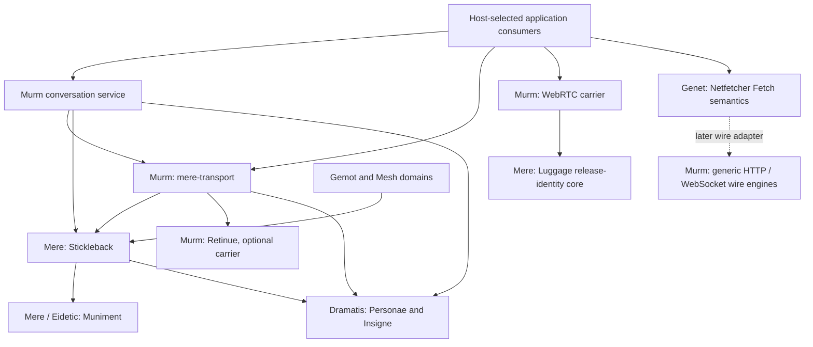

# Murm family and repository move

**Date:** 2026-10-13
**Status:** Plan. The owner authorized the Murm family direction and a move based
on the Retinue repository, preserving crate names and history. This document
selects boundaries and sequences qualification; no repository has been renamed
and no implementation has moved.

**Canonical home:** this repository owns the migration. Mere and Genet should
cite this plan rather than keep another migration specification. Until the
repository rename actually happens, the cross-repository coordinate is
`retinue/design_docs/2026-10-13_murm_family_move_plan.md`.

**Related:** [documentation policy](DOC_POLICY.md),
[murmuration direction](2026-08-09_channel_murmuration.md#current-direction-coordinated-runtime-personalities),
[controller ownership](2026-09-10_murmuration_controller_plan.md),
[transport conformance](2026-10-11_transport_conformance_plan.md),
[retained-repair prototype](2026-10-11_retained_repair_simulation_profile.md).
Adjacent owners: `mere/design_docs/mere_docs/implementation_strategy/2026-07-12_murm_peer_runtime_and_moot_domain_plan.md`
and Genet's current `components/netfetcher/src/lib.rs` / `src/transport.rs`.

## 1. Decision and scope

Murm becomes the family for communication implementations, peer carriers,
network protocols, device participation and control, shared radio runtime, and
their diagnostics. Retinue remains the Reticulum implementation inside that
family. The existing Retinue repository is the foundation; keep its identity,
history, releases, issues and radio tree instead of creating a blank replacement.

The existing `murm` package remains the conversation service. No crate rename,
universal transport trait, or mandatory umbrella facade is required by the
family promotion. Streams, constrained packets, foreign signed feeds and board
control retain their actual identities, delivery and privacy contracts.

Selected placement for the first move:

| Implementation | Current home | Destination / decision |
| --- | --- | --- |
| `retinue`, `outrider`, `sennet`, `tucket` | Retinue `crates/` | Keep names and paths in the foundational repository |
| `tulle`, `selvage`, `seneschal`, `postilion` | Retinue `crates/` | Keep radio, configuration and host contracts together |
| `radio-face`, `radio-hand`, `radio-mirror`, `retinue-sim` | Retinue `crates/` | Keep their present feature/target boundaries |
| `tinyssb-core` | Retinue `crates/` | Keep as a foreign tinySSB feed verifier; family membership is not full SSB chat support |
| `retained-repair` | Retinue excluded workspace | Keep its independently pinned prototype workspace and qualification status |
| Linkboy, Signalman, Signalman desktop, board firmware | Retinue `apps/` and `firmware/` | Keep application identities, independent desktop workspace, images and board-state formats |
| `murm` (lib `murm`) | Mere `crates/murm/murm` | Import to a separate native workspace in this repository |
| `mere-transport` (lib `transport`) | Mere `crates/murm/transport` | Import with scoped identity, shared endpoint and optional Reticulum boundaries intact |
| `mere-webrtc-carrier` (lib `webrtc_carrier`) | Mere `crates/murm/webrtc-carrier` | Import; preserve default core, browser/native features and external Luggage core dependency |
| `stickleback` | Mere `crates/stickleback` | **Keep in Mere for the first move**, as a neutral shared replication supplier |
| `netfetcher` | Genet `components/netfetcher` | **Keep Fetch and browser WebSocket policy in Genet**; qualify reusable wire implementations for Murm later |
| `mere-fetch`, `page-load` | Mere `crates/system/` | Keep host/session orchestration and portable page-load vocabulary with existing owners |

Identity and credential authority remain in Dramatis/Personae. Djinn owns the
resident host and its persisted pairing/operating choices. Gemot owns governed
membership, capabilities and Standing. Distillery owns compute offers and
leases; ESP owns inference/embedding execution. Applications own document,
conversation and activity decisions. A Murm implementation consumes those
owners' inputs and supplies observations; repository placement grants no
additional authority.

## 2. Build and dependency map

Keep two separate stack-wide decisions: the working toolchain and the minimum
supported Rust version (MSRV). Pin the working toolchain to current stable Rust
1.99.0 for this rollout. The selected common owned-package MSRV is **1.97.1**;
it remains below the working toolchain and advances independently when
language use, dependencies or an explicit support decision require it. The
owner rejected both preserving Rust 1.88 by assumption and making Rust 1.99 the
minimum by assumption. The canonical policy is in
`mere/design_docs/2026-08-12_family_composition_thesis_brief.md`, section
"Shared Rust toolchain and minimum version (2026-10-13)".

The locked Mere graph declares Rust 1.91 for Iroh and 1.96 for the refreshed
p2panda supplier. Its highest declared floor is 1.97.1, from WESL/WGSL; Knot
declares 1.97. Fetched owner manifests across eleven active repositories and
2,491 cached registry manifests from 71 tracked lockfiles contain no declared
minimum above 1.97.1. Higher working-toolchain pins, including 1.98.1, are
separate settings and do not by themselves establish a higher MSRV.

This selects a rollout floor, not a tested compatibility receipt. Inspect
undeclared requirements and qualify supported feature/target configurations on
1.97.1 in MOVE1. The registry inventory has 277 uncached package versions and
does not exhaustively resolve independent Git suppliers outside Mere. Any
actual requirement above 1.97.1 must be resolved or brought back into the shared
MSRV decision before claiming stack-wide support. Inventory evidence is saved
in `Code/targets/murm-shared-msrv-selection-20261013.json`.

The two-workspace layout below remains a proposal for dependency, feature and
target isolation. Both roots follow the same working-toolchain policy and the
separately selected common MSRV. Keep a separate native workspace only where
graph qualification demonstrates its value; a unified workspace is acceptable
if radio/firmware dependency cones and profiles remain correct. The independent
desktop workspace follows the same policies as well.

Proposed layout (illustrative; these destination directories do not yet exist):

```text
Murm repository, based on existing Retinue history
  Cargo.toml                  radio workspace / shared toolchain and separate MSRV
  crates/                     existing radio/protocol/control package paths
  apps/                       existing host apps and separate desktop workspace
  firmware/                   existing targets and packaging
  native/
    Cargo.toml                proposed native workspace / same two compiler policies
    crates/murm/              package murm; library murm
    crates/transport/         package mere-transport; library transport
    crates/webrtc-carrier/    package mere-webrtc-carrier; library webrtc_carrier
  design_docs/                this canonical migration plan and existing evidence
```

If the separate native workspace is retained, the root excludes it. Native
defaults must not activate native transports in embedded builds. Owned packages
converge on the selected shared MSRV of 1.97.1; a newer working toolchain
does not change that value automatically.
The WebRTC core still gets its default Wasm check; the native workspace name
does not turn its portable core into a native-only API. Retinue's release
profile is flash-size-oriented; select native profiles explicitly instead of
accidentally inheriting them through repository placement.

Arrows below mean package consumption, not authority transfer. This is a
selected-boundary map, not the entire transitive graph:



The direct dependency inventory is saved as
`Code/targets/murm-family-move-map-20261013.json`, derived from locked Cargo
metadata. It records seven relevant packages and 33 consumer edges, including
dependency kind, optional features and target conditions. It also exposes the
non-obvious address-book edge: `mere-transport` already consumes Stickleback.

### Stickleback stays a shared supplier

Stickleback's normal dependencies include Muniment, Personae/Insigne,
`mere-proofs` and p2panda. It does not depend on the Murm transport or on Gemot.
Keeping it in Mere permits Murm's transport and conversation packages to
consume it while Gemot, Mesh and the host applications remain independent
domain consumers. A repository relationship in both directions is acceptable
only while the actual package graph stays acyclic and sources stay immutable.
Do not make the new native workspace depend on Mere's aggregate application or
ports to reach these leaf suppliers.

Moving Stickleback into Gemot is rejected for this first move: generic
replication would become owned by one governed-space consumer. Extracting it
with its shared suppliers later remains possible if release coordination
proves awkward. That is a separate change with all consumers represented,
rather than a prerequisite for the carrier/radio family promotion.

### Netfetcher: take the wire, keep the web contract

The historical standalone Netfetcher repository is archived. The active source
is Genet `components/netfetcher` at `7a8c5b8cb49`, package version 0.1.1. Its
September 2 authority split is explicit: web-observable Fetch behavior stays
above `netfetcher::Transport`; the host supplies the wire through
`FetchContext.transport`. Feature-disabled builds retain semantics without the
HTTP wire implementation, although they still have runtime/helper dependencies.

Genet retains CORS, redirects, cookies, response tainting, cache semantics,
referrers, mixed-content handling, CSP, integrity and content decoding.
Murm may provide pooling, TLS connections, HTTP/1-2-3 exchange, proxies,
timeouts, connection diagnostics and raw WebSocket carriage. Host policy still
selects trust, credentials, partitions and limits.

The existing seam uses `netfetcher::Method` and its body stream, and WebSocket
`connect` mixes HSTS/CSP/cookie policy with the tungstenite connection call.
Moving those files wholesale would move policy too. Select a generic wire
engine boundary before extraction. The dependency-safe composition is a Murm
wire engine using protocol-level values (for example `http` types) with no
dependency on Netfetcher, plus an adapter in Genet implementing Netfetcher's
existing seam. Genet can then depend on the Murm engine; the engine must not
depend back on Netfetcher. Preserve public Netfetcher entry points through that
adapter, without leaving two shipping wire engines as competing authorities.

HTTP/3 and Iroh both using QUIC does not make their protocols or endpoints
interchangeable. Keep their wire protocols and trust inputs explicit. Browser
WebSocket policy checks occur before opening the raw connector, and response
cookie processing remains with the policy owner after connection.

## 3. History, package identity and durable data

Use the existing Retinue repository as the continuing repository. Preserve
Retinue commits, tags, published release references and existing merged radio
histories. Import selected Mere trees through a history-preserving merge that
retains the unfiltered source commit as a parent/ancestor, with only selected
trees present at the destination tip. Source commits must remain reachable in
a fresh clone. A rewritten subtree split alone does not satisfy preservation
of original commit IDs.

The execution recipe must be rehearsed in a disposable repository before it
touches the destination branch. Attach the source ancestry, stage the selected
trees under the native paths, and inspect the resulting merge before committing.
Do not merge the whole current Mere tree into the destination working tree.
Git's [merge documentation](https://git-scm.com/docs/git-merge) and
GitHub's [subtree merge recipe](https://docs.github.com/en/get-started/using-git/about-git-subtree-merges)
describe the ancestry/tree distinction. Acceptance includes `merge-base
--is-ancestor` for representative original commits, original object availability
in a fresh clone, blob equality before manifest edits, original author/message
preservation, and an attribution check across the path move. Do not assume
`log --follow` or blame navigation survives automatically.

Retaining unfiltered Mere ancestry also retains its other historical objects.
Current packed-object context is approximately 216 MiB for Mere and 25 MiB for
Retinue; that is not a measured incremental import or future clone size.
Measure the rehearsal. A later original-ID-preserving Genet wire extraction
would also need to account for Genet's full ancestry rather than conceal it
behind rewritten split commits.

Preserve package names, library aliases, feature names, wire identifiers and
ownership boundaries. Materialize inherited edition, version and license fields
in the receiving workspace without silently applying one family-wide license.
Keep per-crate LICENSE, NOTICE, provenance ledgers and vendored terms with their
sources. Repository metadata may change for new releases; published versions
and their old metadata remain historical records. Do not attempt to republish
an existing version under a new home.

This move does not alter board owner records, A/B journals, configuration
magics, replay counters, conversation IDs, signed post identities, key scopes,
ALPNs, native-drop codecs or installed firmware. No board is flashed as a side
effect of repository restructuring.

## 4. Move phases and done conditions

### MOVE0: freeze sources and establish import boundaries

Record the Retinue foundation, the reviewed Mere import ref, package contents,
Cargo graph, consumer pins, licenses, workflows, release/feed paths and
historical test scope. Retinue baseline is `973e317a0`; Mere's current refresh
candidate is `31e6dbf18`, with published p2panda supplier tag
`mere-p2panda-net-0.7.5-upstream-20261013`. Mere main also has a later doc-only
commit at the time of planning. Choose the actual immutable import ref after
reconciling the refresh with current main; this document does not declare that
local candidate integrated or deployed.

Registry lookups confirm the selected versions of Stickleback (0.1.1),
Muniment (0.1.2) and `mere-proofs` (0.1.0) exist; existence alone does not prove
supplier identity or API equivalence. Inspect their exact source/package
contents. WebRTC's Luggage dependency is currently a path-only supplier in Mere
with native defaults explicitly disabled. Confirm an exact external release or
immutable Git leaf dependency before import. Keep the updater application and
update policy outside Murm.

**Done when:** every imported file and needed external leaf supplier has a
source/identity entry; all normal/dev/target consumers and fork patches have
been inventoried; the original-ID import rehearsal passes; source authority
and toolchain boundaries are resolved. Planning evidence does not close the
actual import gate.

### MOVE1: unify Rust and establish the receiving build roots

Inventory toolchain pins, owned `rust-version` fields, CI compiler jobs and
independent workspace/probe/firmware roots across the active stack. Pin the
working toolchain to the coordinated current stable release (1.99.0 for this
pass). Independently qualify the selected common MSRV, 1.97.1, against source
requirements and supported dependency/feature/target graphs, then align owned
minimums to `rust-version = "1.97.1"`.
Use a current-toolchain CI lane for development checks and a separate selected
MSRV lane for supported builds/tests. Upgrade the working pin without raising
the MSRV automatically. An actually required target compiler fork/nightly must
be recorded as a target realization, with its capabilities checked against the
support policy; it does not create an assumed older radio MSRV policy.

Use Cargo's supported `build.build-dir` for intermediate artifacts and retain
`build.target-dir` for delivered outputs. Inventory environment overrides,
cache keys, release scripts and executable-path discovery; tests must obtain
executable locations from Cargo output rather than assume an intermediate
`target/debug/deps` layout. Keep worktree/platform/configuration isolation.

Qualify the proposed native workspace and root exclusion, or select one
workspace if its graph remains bounded. Record profiles; carry the immutable
shared p2panda patch set in each consuming build root because dependency
workspaces' patches do not propagate to consumers. Preserve radio dependency
defaults, desktop isolation and firmware target ownership.

**Done when:** active owned toolchain pins follow the qualified working
release, owned minimums follow the separately selected and tested common MSRV,
and CI checks both; each target's actual compiler is recorded; build-dir
and delivered-artifact paths work in native/browser/embedded and packaging
recipes; receiving workspace graphs resolve only intended suppliers. No
placeholder crate or application dependency stands in for a real leaf
supplier. Check package graphs in every independent build root. Old compiler
receipts do not establish qualification of the new baseline.

### MOVE2: import and qualify the three Mere implementations

Import `murm`, `mere-transport` and `mere-webrtc-carrier` with source ancestry
and selected content. Use external Stickleback, Muniment, proofs, Personae,
Notochord and Luggage core at qualified exact sources. Keep published aliases
and API/wire identities. The existing radio crate may be a local optional
Reticulum dependency inside this repository, but its newer code requires its
own adapter qualification; do not call the current old Mere pin refreshed by
changing a path.

**Done when:** package-content/attribution checks pass; the scoped carrier-key
regression, conversation causality/retention, durable reopen, protected drops
and session admission pass from the receiving workspace. Real QUIC/gossip/
LogSync and optional Reticulum checks have source-bound receipts. WebRTC core,
native and browser feature checks retain their exact scopes. Repeat physical
radio or browser acceptance only with the validation lane and fixture handed
over. Sandbox-denied network execution is an open receipt, never a pass.

### MOVE3: publish suppliers and cut consumers over

Publish immutable sources and new versions where needed, then coordinate
consumer pins. Primary consumers include Mere Comms/Moot, Djinn, Distillery,
Gemot/Commons test seams, native fetch blob paths and Graphshell; also inspect
Turnstone, Woodshed, Knot and Retinue's independent desktop consumer. Update
standalone probe/harness manifests and test/dev edges. Keep one p2panda source
graph and Personae type identity across the composition.

**Done when:** named production consumers resolve the new source under locked
builds, including target-specific/default-off lanes; native and portable
dependency cones remain within their contracts; no sibling checkout override
is required. Source and destination must not both receive independent fixes to
the same implementation during the transition. Remove the old Mere source
trees only after consumer qualification and source attribution are complete.

### MOVE4: canonical repository/name cutover

Rename the existing Retinue repository to Murm, retain its repository identity
and refs, and update remotes, new-release metadata, CI references, packaging,
firmware catalog/feed locators and family documentation together. Keep crate
names and existing paths. Do not recreate a repository at the old name.

GitHub documents redirects for ordinary repository access but exceptions for
Pages project URLs and hosted action calls. Inventory those and verify actual
consumers; redirects are not a complete release/feed qualification. See
[GitHub's rename guidance](https://docs.github.com/en/repositories/creating-and-managing-repositories/renaming-a-repository).

**Done when:** original refs and release artifacts resolve; old links retained
as historical evidence still work where promised; current consumers use the
canonical home; CI, installer/catalog lookups and documentation navigation
pass. Repo rename and package publication each have their own receipt.

### MOVE5: qualify Netfetcher's reusable wire engines

This follows the first family cutover rather than blocking it. Rehearse an
original-history-preserving extraction from the active Genet source. Define
the generic HTTP engine and Genet adapter first, then a raw WebSocket connector
whose policy wrapper remains in Genet. Keep Netfetcher's crate identity,
default feature behavior and public connection/fetch entry points.

**Done when:** literal one-hop tests prove no redirect, cookie, header or body
policy is silently added by the wire engine; existing Fetch and WebSocket
policy refusals still occur before connection; raw status/headers/body and
failure mappings remain consistent. Native HTTP/1-2-3 and WebSocket transport
receipts, Genet harness/Fetch conformance gates, host partition/trust checks and
feature-disabled dependency checks are separate. Prove no Genet/Netfetcher
dependency back-edge in the generic Murm engine. Publish and adopt only after
Genet's `genet-wpt` host and Mere's `mere-fetch` host demonstrate the same
boundary. The current default transport uses a process-wide pool; preserving
it does not establish per-session trust or pool isolation. A host-selected
partitioned transport needs explicit configuration and its own receipt.

## 5. Findings and progress

### 2026-10-13 planning pass

- The foundational Retinue tree already contains the requested protocol,
  radio, UI and management leaves. Its root manifest and CI currently declare
  a Rust 1.88 lane, while the owner now requires a shared current working
  toolchain and the separately selected shared MSRV of 1.97.1 across the stack.
  The old values are migration inputs, not an owner commitment to preserve them. Genet-backed desktop and retained-repair
  prototype workspaces remain excluded for dependency/target reasons.
- Locked Mere metadata identifies seven relevant supplier packages and 33
  consumer edges. Stickleback has no normal transport/Gemot dependency;
  `mere-transport` consumes Stickleback for its address book. WebRTC consumes
  Luggage's release-identity core. These edges determine the first move.
- Netfetcher's archived standalone clone is not the import source. The current
  Genet tree explicitly owns web-observable semantics above the one-hop seam;
  WebSocket policy and connection calls still share one module and need a real
  extraction boundary.
- Source checks select **Stickleback in Mere** and **Netfetcher semantics in
  Genet**. Generic HTTP/WebSocket wire code is a later Murm lane. These choices
  keep Gemot governance, host persistence, identity and update policy explicit.
- The earlier Murm refresh receipt records 289 passing owner/admission tests,
  with twelve network cases excluded by OS-monitor sandbox restrictions. It is
  source qualification evidence, not acceptance of an imported crate or new
  physical/browser behavior.
- This pass created the map and plan only. MOVE1-MOVE5 are unexecuted. Registry,
  history and direct-dependency inspection do not replace the receiving build,
  publication, consumer or physical receipts.

### 2026-10-13 compiler-policy correction

The owner clarified that Rust 1.88 was not a requested compatibility promise.
He wants the newest working Rust, including build-directory support, and a
unified minimum across the stack. The initial Rust 1.88 preservation inference
is withdrawn. The subsequent interpretation that the newest toolchain must
also be the MSRV is withdrawn too. Rust 1.99.0 is the selected working release;
build-dir support stabilized in Cargo 1.91. At this correction stage, the shared MSRV was a separate,
unselected decision; the subsequent selection is recorded below. Locked
dependency declarations made 1.96 a Murm candidate and identified wider-stack requirements at 1.97/1.97.1 for qualification or
supplier adjustment. No MSRV compiler runs were performed in this correction.
Repository manifests and CI still require the MOVE1 rollout; this document
does not claim that the stack has already been upgraded.

### 2026-10-13 shared MSRV selection

The owner accepted 1.97.1 if no requirement pins a higher minimum. Fetched
owner-manifest and locked-dependency declaration inventories found no higher
floor in their inspected scope. Select Rust 1.97.1 as the shared owned-package
MSRV and retain Rust 1.99.0 as the working toolchain. MOVE1 must qualify the
actual supported configurations on both compilers before claiming the rollout
complete; declarations, uncached suppliers and existing development pins do
not substitute for those compiler runs. The stack-wide manifest/CI rollout
remains unexecuted.
