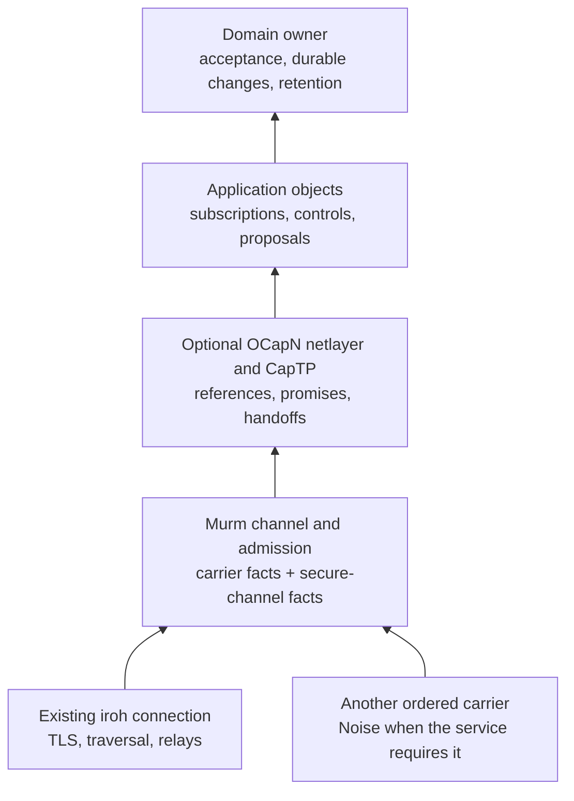

# Secure sessions and optional live interaction

**Status:** 2026-10-30: N1 landed across Murm, Dramatis/Notochord and Knot with
focused software and local-network acceptance. N2's bounded security policy and
N3's native process/carrier qualification passed. The optional OCapN runtime
and bounded Gemot/coop adapter are implemented and qualified for their declared
native software and pinned wire subset. O4's broader handoff/netlayer work,
product UI and physical-device qualification remain open. The
[qualification record](archive_docs/2026-10-29/2026-10-29_secure_sessions_and_live_interaction_plan_receipts.md)
keeps exact source revisions, commands and evidence limits.

**For:** a reusable authenticated session over Murm's ordered carriers, followed
by an optional Rust OCapN live interaction layer on the existing iroh endpoint.
Murm owns connection establishment and carriage; applications expose bounded
capabilities and their domain owners retain mutation, replication and retention
authority.

This is the home for generic host secure-channel facts and the former AT1
integration work. The [compact-feed/local-control plan](2026-08-25_compact_signed_feed_and_local_control_plan.md#at1-keep-carrier-and-secure-channel-facts-distinct)
keeps embedded secure-attachment feasibility in AT0. The
[transport consolidation plan](2026-10-28_transport_consolidation_plan.md)
owns endpoint authority and existing consumer consolidation. Neither plan's
other gates depend on adopting OCapN.

## Decisions

### secure_sessions_and_live_interaction D1 — ordering and endpoint reuse

**2026-10-29 · new.** Mark:

> yeah, let's write this up as a murm design plan, with the Noise/AT1 work first and OCapN as an optional live interaction layer over the existing iroh endpoint.

Links: area transport · draws on [transport consolidation](2026-10-28_transport_consolidation_plan.md) · plans N1–N3, O1–O4 · summary Noise/AT1 first, optional OCapN on the existing endpoint

The order and endpoint reuse are decided. The detailed contracts below are the
implementation targets; O1 must settle the supplier and interoperability profile
before a product dependency is added.

### secure_sessions_and_live_interaction D2 — first live consumer

**2026-10-30 · refines D1.** Mark:

> Continue into OCapN after N2/N3, using a bounded Gemot/coop adapter

Links: area transport · amends secure_sessions_and_live_interaction D1 · plans N2–N3, O1–O3 · summary qualify the secure foundation, then expose a bounded Gemot/coop live adapter

Gemot's governance, membership, delegation and durable command boundary remain
independent of the optional live runtime. The adapter maps current authority to
narrow exported operations; invocation still enters the owning domain's checks.
OCapN handoffs cannot silently transfer identity-bound community grants.

## Boundary and intended use

OCapN would supply live object references, asynchronous messages, promises and
third party handoffs. Useful application objects include a revocable view
subscription, a session invitation, a preview/query service, or a bounded edit
proposal interface. An application chooses what it exports. A connected peer
receives only the authority of the objects deliberately shared with it.

The initial composition is:

The diagram is an architectural target, not a new public API. Murm remains the
authority for binding endpoints, registering ALPN handlers, peer routes,
tickets, discovery, relays and carrier diagnostics. OCapN uses an admitted
channel from that authority; it does not bind another endpoint or introduce a
second discovery or identity-custody system. Keep the protocol/runtime behind
an optional feature or package boundary; ordinary Murm exchange and offline
consumers must build without it. Package names are left to O1.

Personae owns identity, derived keys and delegation; Notochord owns admission.
An OCapN reference can confer a limited application ability, but connecting or
receiving a reference grants no general capture, retention, publishing or
document-edit authority. Durable operations still pass through the owning
domain and, where applicable, Stickleback's accepted-operation path. The
replication and group-key work remains in
`mere/design_docs/mere_docs/implementation_strategy/2026-10-28_murm_runtime_plan.md`.

Goblins is also an actor runtime. Implementing OCapN's wire protocol in Rust
does not import its transactional turns or make arbitrary Rust code capability
secure. Exported objects need deliberate wrappers around filesystem, network,
execution and mutation authority. A remote peer cannot select arbitrary local
methods, services or ambient handles.

CapTP needs a bidirectional, reliable, ordered channel. Start with one ordered
stream per session. High frequency disposable presence samples and media may
use separate coalesced or datagram lanes with their own authority binding;
this plan makes no hard real-time or audio scheduling claim.

## Secure-session contract

### Three separate meanings of identity

Preserve three records throughout setup and admission:

| Record | Meaning | Owner |
| --- | --- | --- |
| Carrier facts | Protocol, authenticated carrier peer when available, shared link identity, and local ingress context | Murm carrier |
| Secure-channel facts | Profile-proved peer key, security profile/version, session binding, and authenticated application protocol; a native profile may prove an endpoint key | Secure-session implementation |
| Admitted principal and capabilities | Accepted identity/delegation, permitted actions, expiry and revocation | Personae/Notochord and application owner |

A Noise-proven key never fills an absent carrier-authenticated peer field.
Equality of outer and inner identities is an explicit service policy, including
Knot's existing publishing policy until its owner selects a broader one.
Distinct identities require the delegation or binding that policy asks for;
two valid handshakes alone do not establish that relationship. Check the
expected remote identity from a trusted invitation or grant before releasing
application capabilities. Completing Noise XX does not persist a TOFU decision
or authorize an arbitrary newly encountered key.

For native iroh, an existing scoped endpoint key need not be the application's
stable Personae root. Notochord's explicit `BoundChannelApplicationProof` policy
verifies the root's checked signer and v2 signature over this actual stream
binding and requested action. This proves consent to this particular channel;
it makes no claim of durable endpoint-key ownership. The adapter checks the
trusted expected server endpoint before issuing that proof. This authenticates
the initiating application root and the expected responder endpoint; a distinct
responder application root needs its own proof. Existing strict identity
policies and Knot's selected Noise policy retain their behavior.

Export a verified session binding from the Noise handshake rather than
reconstructing it from public key bytes. Bind the handshake hash, selected
security profile/version, application protocol and participant roles through
one domain-separated admission transcript. Bind available carrier peer and
shared-link facts into that transcript, preserving Reticulum's shared-link
replay protection. Local interface identifiers remain responder-owned policy
context and are excluded from common signed transcript material. The exact
encoding and compatibility/version change are N1 work.

### Optional means owner-selected policy

Each service declares its required confidentiality, authentication, expected
principal and allowed security profiles. A native secure carrier can satisfy
those requirements only when the selected service profile permits it and its
identity binding is sufficient. Otherwise, establish the configured Noise
session. The OCapN profile selected in O1 determines its exact wire handshake;
the runtime cannot silently omit that handshake because the outer carrier is
encrypted.

Explicitly public or physical-possession-only services may allow an unencrypted
profile under their owner's policy. A required secure handshake that fails is
a refusal; it never triggers a plaintext retry. Authenticate security selection
and protocol/version negotiation so an attacker cannot induce a weaker mode.
Privileged object references and bearer invitations require confidentiality.

Iroh already encrypts traffic end to end, including through relays. Inner Noise
can add an independent application identity/trust boundary or continue through
an application proxy that terminates an outer connection. It is not needed to
hide iroh plaintext from its relay. Distinct application keys also do not hide
the reached carrier endpoint from the other carrier endpoint.

Reticulum's reliable links also encrypt traffic end to end. Its absent
carrier-proven initiator key does not mean plaintext: encryption and proof of
the application's Personae identity are separate observations. A direct native
Reticulum profile needs a verified link binding and application proof adapter
before this setup policy can accept it. The qualified Reticulum composition
here continues to use Noise for that application binding. Announces, routing
metadata, sizes and timing are outside the bilateral payload-confidentiality
claim; retained data and group keys keep their own protection.

The existing Murm profile uses `Noise_XX_25519_ChaChaPoly_BLAKE2b`, an encrypted
protocol declaration, and a Mere-specific Ed25519 proof. Keep its profile
explicit. Sharing the Noise framework with another implementation does not
establish interoperability: suite, framing, proof, negotiation and key binding
must match. Preserve existing users or make any wire change explicitly
versioned.

Carrier protocol and authenticated inner application protocol remain separate
facts and are both signed. The generic binding supports an opaque outer
protocol carrying a different inner service; each service adapter checks its
own expected values. Knot publishing deliberately requires its publishing
protocol at both layers.

Noise operates over a live bilateral session. Retained-object encryption,
offline store-and-forward protection, group membership/epochs and message
ratchets retain their own owners. A wrapper over `AsyncRead + AsyncWrite`
does not provide raw datagram reliability, radio segmentation or embedded
execution. A carrier must first meet the ordered-channel contract.

## Phases

### N1. Separate secure-channel facts and complete AT1

**Status:** landed in source with focused admission and publishing acceptance.

Extend the shared host contract in `mere-transport`, Personae/Notochord and
Knot's publishing consumer. This phase owns the acceptance criteria formerly
listed under AT1; AT0's host/device and embedded proof remains separate.

- Done when: verified secure-channel facts expose the session binding and
  proven peer; the carrier record survives unchanged; initiator and responder
  derive one versioned admission transcript; Murm and Knot use the same fact
  vocabulary rather than hand-built conversions.
- Done when: a service requiring matching carrier/Noise identities rejects a
  mismatch; a policy-authorized distinct application identity succeeds only
  with its required proof; Reticulum plus Noise can admit a correctly bound
  Personae subject while its carrier peer remains absent.
- Done when: a captured proof fails on a different Noise session, protocol,
  role or Reticulum link; an unexpected remote key fails before object exports;
  a local interface number is never signed as shared identity.
- Needs: coordinated changes in Dramatis's admission packages and Knot
  consumer. Murm's local primitive tests alone cannot close consumer adoption.

### N2. Apply explicit security policy and bound session setup

**Status:** implemented, independently reviewed and accepted with N3 process
qualification and Knot's published receiving-source integration.

Integrate the existing Noise primitive into service setup under explicit
requirements. Correct its relay/identity privacy documentation as part of this
phase. Define byte, frame, pending-session, allocation, work and deadline limits
before accepting an untrusted handshake or identity proof.

- Done when: allowed native-secure and Noise profiles satisfy the same declared
  service requirements; plaintext is accepted only by a service that explicitly
  permits it; failed or unsupported required security has no downgrade path.
- Done when: malformed, oversized, truncated, stalled and cancelled setup
  returns a bounded refusal and releases resources; protocol/profile selection
  is authenticated; application bytes cannot reach a privileged handler before
  admission. Limit values are explicit in configuration and exercised at their
  boundaries.
- Done when: existing Knot profile behavior is preserved or migrated under an
  explicit version; diagnostics distinguish carrier establishment, secure
  handshake, admission refusal and application acceptance without logging
  secrets or bearer capabilities.
- Needs: N1.

### N3. Qualify the same secure service on two carriers

**Status:** accepted for native local process/network scope over all declared
profiles. Native Reticulum without Noise, remote hosts, physical radios,
firmware and browsers retain separate qualification.

Exercise one bounded host service over existing iroh and a second ordered
carrier. TCP is the first controlled unencrypted-carrier fixture. Reticulum
adds a distinct acceptance case for N1's honest absent carrier identity;
its live network and radio behavior retain separate receipts.

- Done when: the service makes equivalent admission decisions over iroh and
  Noise-over-TCP, and Reticulum-plus-Noise covers shared-link binding and an
  absent carrier peer; wrong keys, tampering, replay, cancellation and slow
  consumers are refused or bounded as specified.
- Done when: disconnect, shutdown and carrier change release the old session;
  reconnect performs a fresh handshake and admission with fresh ephemeral and
  cipher keys, per-session counters and a new session epoch. Long-lived identity
  keys are retained or rotated under their owner's policy; no capability or
  pending command silently resumes from old cipher state.
- Done when: software fixtures and a native two-process exchange pass with
  explicit failed cases. Report native, browser, physical-radio and embedded
  results separately; this phase does not close AT0 or group-key work.
- Needs: N1 and N2. Optional OCapN implementation starts after this shared
  secure-session contract is accepted.

### O1. Select the optional Rust OCapN implementation and wire profile

**Status:** intake selected an owned bounded Rust runtime in optional
`murm-ocapn`, with a separate `murm-ocapn-transport` endpoint/admission adapter.
Implementation and independent supported-subset interoperability are qualified.
The declared `ocapn-suite-31f0b806` profile matches the pinned independent suite's
legacy message forms; it is not a claim of current-draft or full OCapN support.
The first pass explicitly refuses third-party handoffs and duplicate-session
crossed hellos rather than assigning identity-bound community grants to them.
An upstream encoding change requires a new explicit profile and independent
fixture intake; it must not redefine this pinned legacy profile silently.

Compare adoption of available Rust work with implementing a bounded adapter
and runtime. Freeze the chosen specification/profile, Syrup codec, netlayer
handshake, peer locator/identity rules and independent interoperability peer
in the implementation's provenance and fixture records. Settle licensing and
maintained source availability before importing a supplier.

- Done when: the chosen source is available and reviewable; supported protocol
  features and omissions are explicit; the default build excludes it; a
  package/feature boundary keeps OCapN out of carrier-only and offline users.
- Done when: the adapter consumes Murm's ordered admitted channel on the
  existing endpoint, and any required OCapN Noise profile remains distinct
  from Murm's internal profile unless exact compatibility is demonstrated.
- Done when: version, locator identity, crossed-hello handling and duplicate
  session resolution are defined for the chosen profile. Adding a carrier is
  not assumed to preserve capability or grant identity; that equivalence needs
  an explicit rule and test.
- Needs: N3. Wire compatibility is a separate claim from a local self-test.

### O2. Run one bounded live capability service on the existing endpoint

**Status:** implemented and qualified for the declared native software scope. The first
consumer is `mere/ports/moot`'s optional `ocapn-coop` feature: a fixed collection
view, callback subscription and membership proposal, with no endpoint ownership
in the runtime or product adapter.

Register the selected versioned protocol through `P2pandaTransport`'s existing
ALPN/service seam. Use one reliable ordered stream per CapTP session, following
the selected profile's peer-pair session rules. The first consumer is a
revocable join-and-subscribe service for a view; the concrete product owner is
selected before implementation. Third party handoffs may remain disabled until
O4, and unsupported operations must fail explicitly.

- Done when: a peer joins through an admitted invitation and receives only a
  bounded subscription capability; exports, imports, promises, pending answers,
  mailbox bytes, subscribers and per-peer work all have explicit limits.
- Done when: a slow or hostile subscriber cannot retain unbounded resources or
  stall unrelated Murm services; cancellation, peer loss and endpoint shutdown
  break outstanding work and release tables, tasks and subscriptions.
- Done when: enabling the service creates no extra endpoint, identity store,
  relay configuration or discovery loop; disabling it leaves existing Murm
  services usable; its diagnostics are visible through Murm's transport owner.
- Needs: O1 and an application owner. HTTP wire engines, gossip and LogSync
  continue through their existing interfaces.

### O3. Define revocation, reconnect and durable mutation

**Status:** implemented and qualified for session-scoped references and the
bounded collection proposal, including final Git-source consumer checks.
Exact observed heads refuse duplicate or ambiguously retried proposals;
automatic mutation retries, durable references and broader command exports
remain follow-on work.

Use application-owned revocable wrappers or leases. Dropping a local Rust
handle, deleting a locator or closing a UI is not remote authority revocation.
Session-scoped references expire on disconnect; intentionally durable
references require explicit storage, resolution and fresh admission policy.
Treat persisted references and invitation secrets as credentials with owner
custody and redaction rules.

- Done when: revocation and expiry prevent new invocations through every copy
  of a delegated reference; the owner specifies whether already admitted work
  finishes or is cancelled, and the result is tested.
- Done when: reconnect has a fresh session epoch and re-admits the peer;
  unresolved promises fail observably; old session references cannot regain
  authority. Restoration of any durable reference follows its named policy.
- Done when: one bounded durable proposal traverses the owning domain's
  version/authority checks and ordinary history/replication path. Repeated or
  ambiguously completed requests use domain-owned idempotency and receipts;
  the transport never automatically replays a mutation as new work.
- Needs: O2. Product-specific writer authority, undo, retained storage and
  retention stay with their existing owners.

### O4. Qualify interoperability and carrier independence

Expand the first service only after its lifetime and authority rules hold.
Exercise a third peer and the chosen profile's handoff mechanism, then the same
service over an admitted second carrier using the selected secure profile.

- Done when: an independent chosen OCapN implementation exchanges the declared
  supported subset; a handed-off restricted capability preserves its authority,
  target identity, revocation and lifetime; a recipient gains no ambient
  session or document rights.
- Done when: promise pipelining, duplicate-session resolution, malformed input,
  resource exhaustion, disconnect during handoff and reconnect are exercised;
  unsupported features fail explicitly and are excluded from compatibility
  claims.
- Done when: carrier replacement changes carriage while preserving the
  explicitly defined principal/grant semantics. Native two-process acceptance,
  independent implementation interop and any later headed-browser acceptance
  are separately reported.
- Needs: O3. Browser connectivity, physical radios, firmware, media/datagrams,
  broader product exports and general durable-object hosting are follow-on
  decisions, not implied phase completion.

## Findings

- 2026-10-29: [`Transport::connect_session`](../native/crates/transport/src/transport.rs)
  now returns an additive [outbound-session record](../native/crates/transport/src/outbound.rs)
  supplied by each carrier: an authenticated initiator only where proved, and
  the real shared-link identity where available. Unknown adapters report absent
  facts. `local_peer_id` alone does not establish either fact.
- 2026-10-29: the current [native workspace manifest](../native/Cargo.toml)
  sources Personae/Notochord from Dramatis and Stickleback from Eidetic. Their
  source changes belong there; the Mere runtime plan coordinates consumers and
  domain behavior rather than owning these supplier packages.
- 2026-10-29: [`Transport`](../native/crates/transport/src/transport.rs) already
  supplies ALPN-scoped `AsyncRead + AsyncWrite` streams.
  [`P2pandaTransport`](../native/crates/transport/src/p2panda_transport.rs)
  provides `alpns` registration and `protocol_endpoint`; endpoint reuse is an
  existing integration seam.
- 2026-10-29: [`noise::handshake_with_facts`](../native/crates/transport/src/noise.rs)
  now returns the verified role-ordered identities, exact internal XX/BLAKE2b
  profile/version and handshake hash. The secure variants retain the inner
  protocol and the [Notochord adapter](../native/crates/transport/src/notochord.rs)
  converts them to the shared admission vocabulary. Legacy Noise APIs and wire
  behavior remain intact; the [`noise` feature](../native/crates/transport/Cargo.toml)
  remains default-off and independent of Notochord.
- 2026-10-29: [`AcceptedSession`](../native/crates/transport/src/accepted.rs)
  and its [`Notochord conversion`](../native/crates/transport/src/notochord.rs)
  preserve absent carrier authentication and local/shared ingress distinctions.
  Knot's N1 consumer intake uses secure v2 admission while retaining equality
  when a carrier authenticates a peer, and checks the publisher ticket before
  disclosure. Its owning source is
  `knot-editor/crates/knot-editor/src/publish_carrier.rs` and `publish_client.rs`.
- 2026-10-29: Dramatis's `crates/notochord/src/secure.rs` retains the original
  carrier record alongside verified secure facts. Its explicit identity policy
  admits the proved subject or its checked session signer and still enforces a
  service's actual carrier-authentication requirement. The v2 transcript is
  additive; the legacy carrier-only public shapes and v1 transcript remain
  intact.
- 2026-10-29: the new real Reticulum local-TCP case in
  [`tests/notochord.rs`](../native/crates/transport/tests/notochord.rs) admits a
  granted subject through Noise and secure v2 while preserving the real shared
  link and absent carrier peer. Knot's publishing tests cover its consumer,
  including real P2panda loopback, publisher checking before disclosure and
  cross-session/link replay refusal. These do not establish physical-radio,
  firmware, headed-browser or broader N2/N3 acceptance.
- 2026-10-29: Knot publishing now requires secure admission wire v2 without a
  v1 fallback. Its application grammar and `mere/knot-publish/v1` ALPN remain
  unchanged. Existing admission peers must upgrade together. Iroh-specific
  deployment tickets still require carrier-specific routing adaptation before
  broader publishing carrier claims.
- 2026-10-29: the source test
  `noise_over_an_iroh_stream_layers_a_second_identity` in
  [`noise/tests.rs`](../native/crates/transport/src/noise/tests.rs) exercises
  distinct identities. Its presence does not qualify production admission or
  cross-carrier behavior. The source comments about relay secrecy and hiding
  the reached endpoint overstate what inner Noise provides; N2 corrects them.
- 2026-10-29: Murm's [conversation status](../native/crates/murm/README.md#status)
  explicitly leaves live group-key distribution/history open. Bilateral Noise
  does not close that work.
- 2026-10-30: the shared [security setup module](../native/crates/transport/src/security.rs)
  now keeps one service-owned capacity lease and deadline through establishment,
  selected security and application admission. The owner selects Noise, native
  iroh or explicit public plaintext; no failed secure mode retries plaintext.
  Plaintext produces no authenticated peer or secure admission evidence.
- 2026-10-30: native [iroh channel evidence](../native/crates/transport/src/p2panda_transport/native_security.rs)
  comes from the concrete backend stream. Its TLS exporter context binds the
  stream identifier, ordered endpoint identities, selected service, actual
  negotiated TLS ALPN and profile/version. Another stream on the same TLS
  connection has a different admission binding.
- 2026-10-30: the [native process fixture](../testing/secure-sessions-n3/README.md)
  exercises one admitted service with Noise over raw TCP, iroh and Reticulum,
  and with native iroh security. The native stream API is above TLS, so the
  fixture explicitly excludes packet-level ciphertext mutation for that mode.
  Native Reticulum without Noise, physical radios and headed browsers retain
  separate qualification gates.
- 2026-10-30: the references below, rechecked upstream for O1. Rexa's last
  commit is 2024-06-07; it is unpublished, LGPL-3.0-or-later, and its
  workspace takes `syrup` from a path outside the repository, so it does not
  build on its own. The Goblins/iroh demo's Rust library is still unpublished.
  OCapN has ratified nothing: the group agreed in August to replace Syrup with
  a new concrete encoding ([ocapn#275](https://github.com/ocapn/ocapn/issues/275),
  open), and on 2026-10-13 removed `op:get`, `op:index` and `op:untag`
  ([ocapn#293](https://github.com/ocapn/ocapn/pull/293)); pipelining through
  `op:deliver` remains. The pinned `ocapn-suite-31f0b806` profile keeps O1
  clear of that churn; O1's "Syrup codec" wording, and the codec, follow the
  encoding when it settles.
- 2026-10-30: [`murm-ocapn`](../native/crates/ocapn/README.md) is a separately
  optional owned Rust runtime. Its Syrup/CapTP profile declares the legacy
  message forms used by the independent pinned suite. Floating point, arbitrary
  integers, sets, third-party handoffs, sturdyref dialing and crossed hellos are
  refused or outside its declared supported subset. Wire interoperability is
  separate from native Murm netlayer interoperability.
- 2026-10-30: [`murm-ocapn-transport`](../native/crates/ocapn-transport/README.md)
  borrows the existing endpoint, selects native security and admits the
  application root before CapTP starts. The native endpoint test uses
  production scoped-key constructors while both endpoint keys differ from
  their application roots. Another registered service remains usable on those
  same endpoints during the live session. The typed listener requires bounded
  registration before acceptance and carries actual first-stream/queue age
  into the setup deadline; a later gate cannot protect an unbounded earlier
  ingress queue.
- 2026-10-30: the Gemot adapter in `mere/ports/moot/src/ocapn_coop.rs` retains
  Notochord admission as immutable host context and checks current admission,
  membership and the exact typed collection capability. A serialized owner
  coordinator covers reads, emissions, proposals and host ingress updates.
  Proposals use the host's independently authorized ordinary Gemot command,
  exact observed heads and existing outbound operation. Returned receipts
  distinguish the admitted submitter from the actual host author; they do not
  invent remote authorship in durable history.

## External design references

These references motivate the plan; they are not supplier qualification.
Recheck them at O1 intake because the specification and implementations evolve.

- [OCapN overview](https://ocapn.org/),
  [CapTP draft](https://github.com/ocapn/ocapn/blob/main/draft-specifications/CapTP%20Specification.md),
  and [implementation guide](https://github.com/ocapn/ocapn/blob/main/implementation-guide/Implementation%20Guide.md):
  remote references, promises, handoffs and netlayer/session requirements.
- [Iroh encryption and relays](https://docs.rs/iroh/latest/iroh/#encryption):
  endpoint authentication and end-to-end encryption already include relayed
  connections.
- [Noise application responsibilities](https://noiseprotocol.org/noise.html#13-application-responsibilities):
  framing, negotiation and peer acceptance remain application responsibilities.
- [Rust/Goblins and iroh demo](https://tarq.net/posts/ocapn-rust-goblins-wasm/):
  direct feasibility evidence; the article identifies source availability,
  handoff and capability-identity work as unfinished at publication.
- [Rexa](https://github.com/SignalWalker/rexa): a Rust implementation lead with
  substantial protocol work listed as unfinished; not selected by this plan.
- [Endo OCapN Noise](https://github.com/endojs/endo/blob/master/packages/ocapn-noise/README.md)
  and [OCapN status](https://github.com/endojs/endo/blob/master/packages/ocapn/README.md):
  concrete work toward common application identity across transports, with Rust
  crypto compiled to WASM. The implementation is tentative; this plan makes no
  claim that its Noise profile is a ratified OCapN standard or matches Murm's.

## Progress

- 2026-10-29: plan opened with Noise/AT1 before optional OCapN on the existing
  endpoint. Generic AT1 acceptance moved here; embedded AT0 remains in the
  compact-feed/local-control plan. All implementation phases remain open.
- 2026-10-29: Murm's verified Noise facts, honest outbound carrier metadata and
  shared conversion implemented; Dramatis's additive secure v2 admission is
  published. Knot intake and final coordinated N1 acceptance are in progress.
- 2026-10-29: N1 completed: Dramatis, Murm and Knot source integration published,
  final Git-source lock intake accepted, and focused admission/publishing checks
  passed. AT1 is fulfilled by this phase; AT0, N2–N3 and O1–O4 retain their own
  open work.
- 2026-10-30: N2 implemented: explicit service security modes, bounded shared
  setup/admission leases, native iroh stream bindings, cancellation poisoning
  and stage diagnostics. Independent review closed the partial-future
  cancellation gap. Knot's consumer uses the shared gate; final supplier intake
  and N3 carrier process qualification are in progress.
- 2026-10-30: N2/N3 accepted after independent review and native process
  qualification, including native iroh without inner Noise. The optional Rust
  runtime and bounded Gemot/coop adapter now proceed under the declared pinned
  interoperability profile; broader handoffs and current-draft compatibility
  remain O4 work.
- 2026-10-30: the optional bounded Rust runtime, native existing-endpoint
  adapter and Gemot/coop consumer are implemented, independently reviewed and
  published. Final Git-source consumer intake, current authority/expiry,
  exact-head proposal, ordinary replica intake, backpressure and disconnect
  controls passed for the declared subset. O4 and broader product/device
  qualification remain open.
