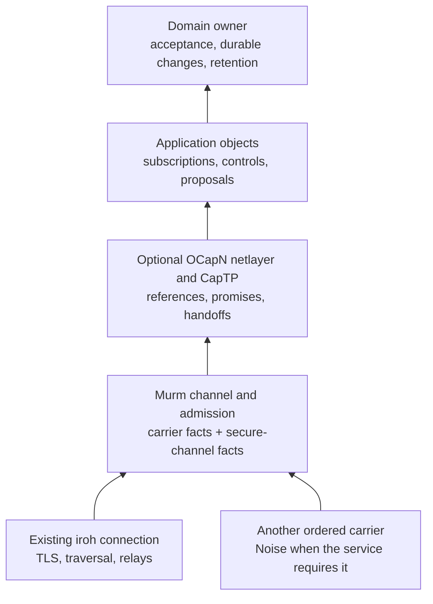

# Secure sessions and optional live interaction

**Status:** 2026-10-31: cut to its open work. N1–N3 and O1–O3 landed on
2026-10-29 and 2026-10-30. The plan as it stood then, with every phase's
done-conditions, findings and progress, is
[archived whole](archive_docs/2026-10-31/2026-10-29_secure_sessions_and_live_interaction_plan.md);
the [qualification record](archive_docs/2026-10-29/2026-10-29_secure_sessions_and_live_interaction_plan_receipts.md)
keeps exact source revisions, commands and evidence limits. Open: O4 and the
deferred items below. The file keeps its name because other plans cite its
phase keys.

**For:** a reusable authenticated session over Murm's ordered carriers, followed
by an optional Rust OCapN live interaction layer on the existing iroh endpoint.
Murm owns connection establishment and carriage; applications expose bounded
capabilities and their domain owners retain mutation, replication and retention
authority.

This is the home for generic host secure-channel facts and the former AT1
integration work. The [compact-feed/local-control plan](2026-08-25_compact_signed_feed_and_local_control_plan.md#at1-keep-carrier-and-secure-channel-facts-distinct)
keeps embedded secure-attachment feasibility in AT0. The
[transport consolidation plan](2026-10-28_transport_consolidation_plan.md)
owns endpoint authority and existing consumer consolidation, including moving
admitted services onto this plan's setup gate (its T6). Neither plan's other
gates depend on adopting OCapN.

## Decisions

### secure_sessions_and_live_interaction D1 — ordering and endpoint reuse

**2026-10-29 · new.** Mark:

> yeah, let's write this up as a murm design plan, with the Noise/AT1 work first and OCapN as an optional live interaction layer over the existing iroh endpoint.

Links: area transport · draws on [transport consolidation](2026-10-28_transport_consolidation_plan.md) · plans N1–N3, O1–O4 · summary Noise/AT1 first, optional OCapN on the existing endpoint

The order and endpoint reuse are decided. The detailed contracts below are the
implementation targets; O1 must settle the supplier and interoperability profile
before a product dependency is added.

### secure_sessions_and_live_interaction D2 — first live consumer

**2026-10-30 · refines D1.** Mark:

> Continue into OCapN after N2/N3, using a bounded Gemot/coop adapter

Links: area transport · amends secure_sessions_and_live_interaction D1 · plans N2–N3, O1–O3 · summary qualify the secure foundation, then expose a bounded Gemot/coop live adapter

Gemot's governance, membership, delegation and durable command boundary remain
independent of the optional live runtime. The adapter maps current authority to
narrow exported operations; invocation still enters the owning domain's checks.
OCapN handoffs cannot silently transfer identity-bound community grants.

## Boundary and intended use

OCapN supplies live object references, asynchronous messages, promises and
third party handoffs; handoffs wait on O4. Useful application objects include a
revocable view subscription, a session invitation, a preview/query service, or a
bounded edit proposal interface. An application chooses what it exports. A
connected peer receives only the authority of the objects deliberately shared
with it.

The composition is:

The diagram is an architectural target, not a new public API. Murm remains the
authority for binding endpoints, registering ALPN handlers, peer routes,
tickets, discovery, relays and carrier diagnostics. OCapN uses an admitted
channel from that authority; it does not bind another endpoint or introduce a
second discovery or identity-custody system. The protocol/runtime stays behind
an optional package boundary; ordinary Murm exchange and offline consumers
build without it. O1 named the packages `murm-ocapn` and `murm-ocapn-transport`.

Personae owns identity, derived keys and delegation; Notochord owns admission.
An OCapN reference can confer a limited application ability, but connecting or
receiving a reference grants no general capture, retention, publishing or
document-edit authority. Durable operations still pass through the owning
domain and, where applicable, Stickleback's accepted-operation path. The
replication and group-key work remains in
`mere/design_docs/mere_docs/implementation_strategy/2026-10-28_murm_runtime_plan.md`.

On one device, Mere does not use CapTP. Its capability door plan
(`mere/design_docs/mere_docs/implementation_strategy/2026-10-30_capability_door_plan.md`)
has Djinn introduce OS channels after consent, with a gateway that meets
`murm-ocapn` at the device edge (its D1). `murm-ocapn` stays an optional edge
profile that nothing local depends on, and that gateway, its G1, waits for a
remote consumer and a settled encoding (its D5).

Goblins is also an actor runtime. Implementing OCapN's wire protocol in Rust
does not import its transactional turns or make arbitrary Rust code capability
secure. Exported objects need deliberate wrappers around filesystem, network,
execution and mutation authority. A remote peer cannot select arbitrary local
methods, services or ambient handles.

CapTP needs a bidirectional, reliable, ordered channel. Start with one ordered
stream per session. High frequency disposable presence samples and media may
use separate coalesced or datagram lanes with their own authority binding;
this plan makes no hard real-time or audio scheduling claim.

## Secure-session contract

### Three separate meanings of identity

Preserve three records throughout setup and admission:

| Record | Meaning | Owner |
| --- | --- | --- |
| Carrier facts | Protocol, authenticated carrier peer when available, shared link identity, and local ingress context | Murm carrier |
| Secure-channel facts | Profile-proved peer key, security profile/version, session binding, and authenticated application protocol; a native profile may prove an endpoint key | Secure-session implementation |
| Admitted principal and capabilities | Accepted identity/delegation, permitted actions, expiry and revocation | Personae/Notochord and application owner |

A Noise-proven key never fills an absent carrier-authenticated peer field.
Equality of outer and inner identities is an explicit service policy, including
Knot's existing publishing policy until its owner selects a broader one.
Distinct identities require the delegation or binding that policy asks for;
two valid handshakes alone do not establish that relationship. Check the
expected remote identity from a trusted invitation or grant before releasing
application capabilities. Completing Noise XX does not persist a TOFU decision
or authorize an arbitrary newly encountered key.

For native iroh, an existing scoped endpoint key need not be the application's
stable Personae root. Notochord's explicit `BoundChannelApplicationProof` policy
verifies the root's checked signer and v2 signature over this actual stream
binding and requested action. This proves consent to this particular channel;
it makes no claim of durable endpoint-key ownership. The adapter checks the
trusted expected server endpoint before issuing that proof. This authenticates
the initiating application root and the expected responder endpoint; a distinct
responder application root needs its own proof. Existing strict identity
policies and Knot's selected Noise policy retain their behavior.

Export a verified session binding from the Noise handshake rather than
reconstructing it from public key bytes. Bind the handshake hash, selected
security profile/version, application protocol and participant roles through
one domain-separated admission transcript. Bind available carrier peer and
shared-link facts into that transcript, preserving Reticulum's shared-link
replay protection. Local interface identifiers remain responder-owned policy
context and are excluded from common signed transcript material. N1 fixed that
encoding as secure admission v2.

### Optional means owner-selected policy

Each service declares its required confidentiality, authentication, expected
principal and allowed security profiles. A native secure carrier can satisfy
those requirements only when the selected service profile permits it and its
identity binding is sufficient. Otherwise, establish the configured Noise
session. The OCapN profile selected in O1 determines its exact wire handshake;
the runtime cannot silently omit that handshake because the outer carrier is
encrypted.

Explicitly public or physical-possession-only services may allow an unencrypted
profile under their owner's policy. A required secure handshake that fails is
a refusal; it never triggers a plaintext retry. Authenticate security selection
and protocol/version negotiation so an attacker cannot induce a weaker mode.
Privileged object references and bearer invitations require confidentiality.

Iroh already encrypts traffic end to end, including through relays. Inner Noise
can add an independent application identity/trust boundary or continue through
an application proxy that terminates an outer connection. It is not needed to
hide iroh plaintext from its relay. Distinct application keys also do not hide
the reached carrier endpoint from the other carrier endpoint.

Reticulum's reliable links also encrypt traffic end to end. Its absent
carrier-proven initiator key does not mean plaintext: encryption and proof of
the application's Personae identity are separate observations. A direct native
Reticulum profile needs a verified link binding and application proof adapter
before this setup policy can accept it. The qualified Reticulum composition
here continues to use Noise for that application binding. Announces, routing
metadata, sizes and timing are outside the bilateral payload-confidentiality
claim; retained data and group keys keep their own protection.

The existing Murm profile uses `Noise_XX_25519_ChaChaPoly_BLAKE2b`, an encrypted
protocol declaration, and a Mere-specific Ed25519 proof. Keep its profile
explicit. Sharing the Noise framework with another implementation does not
establish interoperability: suite, framing, proof, negotiation and key binding
must match. Preserve existing users or make any wire change explicitly
versioned.

Carrier protocol and authenticated inner application protocol remain separate
facts and are both signed. The generic binding supports an opaque outer
protocol carrying a different inner service; each service adapter checks its
own expected values. Knot publishing deliberately requires its publishing
protocol at both layers.

Noise operates over a live bilateral session. Retained-object encryption,
offline store-and-forward protection, group membership/epochs and message
ratchets retain their own owners. A wrapper over `AsyncRead + AsyncWrite`
does not provide raw datagram reliability, radio segmentation or embedded
execution. A carrier must first meet the ordered-channel contract.

## Phases

Landed phases keep their headings so citations hold. Their done-conditions are
in the archived plan and their evidence in the qualification record.

### N1. Separate secure-channel facts and complete AT1

**Landed 2026-10-29.** Carrier facts, verified secure-channel facts and secure
admission v2 are one vocabulary across Murm
([`noise.rs`](../native/crates/transport/src/noise.rs),
[`notochord.rs`](../native/crates/transport/src/notochord.rs),
[`outbound.rs`](../native/crates/transport/src/outbound.rs)), Dramatis
(`crates/notochord/src/secure.rs`) and Knot publishing. AT1 is fulfilled.

### N2. Apply explicit security policy and bound session setup

**Landed 2026-10-30.** [`security.rs`](../native/crates/transport/src/security.rs)
gives each service an owner-selected mode (Noise, native iroh or explicit
public plaintext), one capacity lease and deadline through admission, and no
plaintext retry. Native iroh evidence comes from
[`native_security.rs`](../native/crates/transport/src/p2panda_transport/native_security.rs).

### N3. Qualify the same secure service on two carriers

**Landed 2026-10-30** for native local process and network scope: the
[process fixture](../testing/secure-sessions-n3/README.md) runs one admitted
service over Noise on TCP, iroh and Reticulum, and over native iroh. What it
does not cover is listed under Deferred.

### O1. Select the optional Rust OCapN implementation and wire profile

**Landed 2026-10-30.** An owned runtime,
[`murm-ocapn`](../native/crates/ocapn/README.md), under the pinned
`ocapn-suite-31f0b806` profile. The default build excludes it.

### O2. Run one bounded live capability service on the existing endpoint

**Landed 2026-10-30.**
[`murm-ocapn-transport`](../native/crates/ocapn-transport/README.md) admits the
application root over native iroh security before CapTP starts. Moot's
`ocapn-coop` feature exports a collection view, a subscription and a membership
proposal.

### O3. Define revocation, reconnect and durable mutation

**Landed 2026-10-30** for session-scoped references and the bounded proposal.
Exact observed heads refuse duplicate or ambiguously retried proposals.

### O4. Qualify interoperability and carrier independence

**Status:** open. The current OCapN draft is still moving (Findings); a new
profile follows the settled encoding and does not redefine
`ocapn-suite-31f0b806`.

Expand the first service only after its lifetime and authority rules hold.
Exercise a third peer and the chosen profile's handoff mechanism, then the same
service over an admitted second carrier using the selected secure profile.

- Done when: an independent chosen OCapN implementation exchanges the declared
  supported subset; a handed-off restricted capability preserves its authority,
  target identity, revocation and lifetime; a recipient gains no ambient
  session or document rights.
- Done when: promise pipelining, duplicate-session resolution, malformed input,
  resource exhaustion, disconnect during handoff and reconnect are exercised;
  unsupported features fail explicitly and are excluded from compatibility
  claims.
- Done when: carrier replacement changes carriage while preserving the
  explicitly defined principal/grant semantics. A carrier claim names its
  class: IP-rate carriers and LoRa-rate Reticulum interfaces are qualified
  separately. Native two-process acceptance, independent implementation
  interop and any later headed-browser acceptance are separately reported.
- Needs: O3. Browser connectivity, physical radios, firmware, media/datagrams,
  broader product exports and general durable-object hosting are follow-on
  decisions, not implied phase completion.

## Deferred and follow-on

- **Native Reticulum profile.** A direct profile needs a verified link binding
  and an application-proof adapter. Until then Reticulum services set up
  through Noise.
- **Hosting the coop service.** Only a test crate registers its listener
  (Findings). A host and product UI belong to Gemot and Moot's owners.
- **Durable references and broader command exports.** O3 left these out;
  automatic mutation retry stays refused.
- **Knot carrier routing.** Iroh-specific deployment tickets need
  carrier-specific routing before broader publishing-carrier claims.
- **Current-draft encoding.** When [ocapn#275](https://github.com/ocapn/ocapn/issues/275)
  settles, a new explicit profile with independent fixture intake.
- **Qualification beyond native software.** Remote hosts, physical radios,
  firmware and headed browsers are reported separately. Embedded secure
  attachment stays AT0 in the compact-feed plan.
- **Group keys.** Live group-key distribution and history stay open in
  Murm's [conversation status](../native/crates/murm/README.md#status) and
  Mere's runtime plan. Bilateral Noise does not close that work.
- **Device-edge gateway.** Mere's capability door G1 maps local door services
  to `murm-ocapn`. It needs this plan's N1 and O3, both landed, and waits on
  its own D5.

## Findings

Findings from N1 to O3 that no open item needs are in the archived plan.

- 2026-10-29: Knot publishing requires secure admission wire v2 without a
  v1 fallback. Its application grammar and `mere/knot-publish/v1` ALPN remain
  unchanged. Existing admission peers must upgrade together. Iroh-specific
  deployment tickets still require carrier-specific routing adaptation before
  broader publishing carrier claims.
- 2026-10-30: the shared [security setup module](../native/crates/transport/src/security.rs)
  keeps one service-owned capacity lease and deadline through establishment,
  selected security and application admission. The owner selects Noise, native
  iroh or explicit public plaintext; no failed secure mode retries plaintext.
  Plaintext produces no authenticated peer or secure admission evidence.
- 2026-10-30: native [iroh channel evidence](../native/crates/transport/src/p2panda_transport/native_security.rs)
  comes from the concrete backend stream. Its TLS exporter context binds the
  stream identifier, ordered endpoint identities, selected service, actual
  negotiated TLS ALPN and profile/version. Another stream on the same TLS
  connection has a different admission binding.
- 2026-10-30: the [native process fixture](../testing/secure-sessions-n3/README.md)
  exercises one admitted service with Noise over raw TCP, iroh and Reticulum
  (reliable links over a local TCP interface), and with native iroh security.
  The native stream API is above TLS, so the fixture explicitly excludes
  packet-level ciphertext mutation for that mode.
- 2026-10-30: upstream, rechecked for O1. Rexa's last commit is 2024-06-07; it
  is unpublished, LGPL-3.0-or-later, and its workspace takes `syrup` from a
  path outside the repository, so it does not build on its own. The
  Goblins/iroh demo's Rust library is still unpublished. OCapN has ratified
  nothing: the group agreed in August to replace Syrup with a new concrete
  encoding ([ocapn#275](https://github.com/ocapn/ocapn/issues/275), open), and
  on 2026-10-13 removed `op:get`, `op:index` and `op:untag`
  ([ocapn#293](https://github.com/ocapn/ocapn/pull/293)); pipelining through
  `op:deliver` remains. The pinned `ocapn-suite-31f0b806` profile keeps O1
  clear of that churn.
- 2026-10-30: [`murm-ocapn`](../native/crates/ocapn/README.md) is a separately
  optional owned Rust runtime. Its Syrup/CapTP profile declares the legacy
  message forms used by the independent pinned suite. Floating point, arbitrary
  integers, sets, third-party handoffs, sturdyref dialing and crossed hellos are
  refused or outside its declared supported subset. Wire interoperability is
  separate from native Murm netlayer interoperability.
- 2026-10-30: [`murm-ocapn-transport`](../native/crates/ocapn-transport/README.md)
  borrows the existing endpoint, selects native security and admits the
  application root before CapTP starts. Another registered service remains
  usable on the same endpoints during the live session. The typed listener
  requires bounded registration before acceptance and carries actual
  first-stream/queue age into the setup deadline.
- 2026-10-30: the Gemot adapter in `mere/ports/moot/src/ocapn_coop.rs` retains
  Notochord admission as immutable host context and checks current admission,
  membership and the exact typed collection capability. Proposals use the
  host's independently authorized ordinary Gemot command, exact observed heads
  and existing outbound operation. Returned receipts distinguish the admitted
  submitter from the actual host author.
- 2026-10-31: the shared setup gate has two users, Knot publishing and
  `murm-ocapn-transport` (plus the N3 fixture). Murm's own
  [`session_lane.rs`](../native/crates/murm/src/session_lane.rs) and five
  Mere services admit peers on Murm endpoints by their own setup, so the gate's capacity lease, deadline through admission and
  no-plaintext-retry rule do not reach them. `SecurityMode` has no WebRTC
  profile. The consolidation plan lists them and takes them up as
  [T6](2026-10-28_transport_consolidation_plan.md#t6-admitted-services-set-up-through-the-shared-gate).
- 2026-10-31: `murm-ocapn-transport`'s `NativeService::new` takes any protocol
  and action, but `NativeService::gemot` and the `GEMOT_ALPN`, `GEMOT_DOMAIN`
  and `GEMOT_SERVICE` constants put one product's names in Murm. Moot's
  `ocapn-coop` feature depends on `murm-ocapn` alone. The one crate that
  registers a listener is `mere/testing/moot-ocapn-coop`, pinned at
  `75eb9108879`; no host serves the coop object.
- 2026-10-31: between two peers, the qualified subset (session-scoped
  references, promises, callbacks) does what a typed request/response service
  on its own ALPN does: the shape of `mere/commons-call/v1`,
  `mere/knot-publish/v1`, `mere/inference-stage/v1` and `isocosm/session/v25`.
  OCapN's distinct return, a narrowed capability handed to a third peer and
  exchange with Goblins or Endo peers, arrives with O4 and the capability
  door's G1.
- 2026-10-31: CapTP's traffic (export and answer bookkeeping, reference
  collection, one framed record per message) is sized for IP-rate carriers.
  N3's Reticulum case ran over a local TCP interface; Reticulum over
  LoRa-rate interfaces is a different carrier class, which O4 now names.
- 2026-10-31: [`murm-ocapn`'s `session.rs`](../native/crates/ocapn/src/session.rs)
  is 1,771 lines and `security.rs` 739.
  [`validation/loc_limit.py`](../validation/loc_limit.py) checks `apps`,
  `crates`, `firmware`, `testing` and `fuzz`, so its 600-line ceiling does not
  reach `native/`.

## External design references

These references motivate the plan; they are not supplier qualification.
Recheck them when a new profile is taken in.

- [OCapN overview](https://ocapn.org/),
  [CapTP draft](https://github.com/ocapn/ocapn/blob/main/draft-specifications/CapTP%20Specification.md),
  and [implementation guide](https://github.com/ocapn/ocapn/blob/main/implementation-guide/Implementation%20Guide.md):
  remote references, promises, handoffs and netlayer/session requirements.
- [Iroh encryption and relays](https://docs.rs/iroh/latest/iroh/#encryption):
  endpoint authentication and end-to-end encryption already include relayed
  connections.
- [Noise application responsibilities](https://noiseprotocol.org/noise.html#13-application-responsibilities):
  framing, negotiation and peer acceptance remain application responsibilities.
- [Rust/Goblins and iroh demo](https://tarq.net/posts/ocapn-rust-goblins-wasm/):
  feasibility evidence; its Rust library is unpublished.
- [Rexa](https://github.com/SignalWalker/rexa): a Rust lead that does not build
  on its own (Findings); not selected.
- [Endo OCapN Noise](https://github.com/endojs/endo/blob/master/packages/ocapn-noise/README.md)
  and [OCapN status](https://github.com/endojs/endo/blob/master/packages/ocapn/README.md):
  concrete work toward common application identity across transports, with Rust
  crypto compiled to WASM. The implementation is tentative; this plan makes no
  claim that its Noise profile is a ratified OCapN standard or matches Murm's.

## Progress

- 2026-10-29 to 2026-10-30: N1–N3 and O1–O3 landed; their entries are in the
  archived plan.
- 2026-10-31: cut to open work and archived whole; the family fit survey added
  to Findings; O4's carrier claim names its class; T6 opened in the
  consolidation plan.
